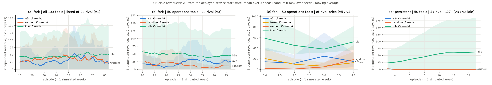

# Learning agents in Crucible: frozen LLM, CAM 2.0, superlearner, neural RL

Code: `crucible/src/crucible/agents/{llm.py, rl.py}`, `crucible/src/crucible/integrations/{__init__.py,
agentrs_cam2.py, agentrs_sl.py}`, `src/agentrs/cam2/envs/crucible_env.py` (AGENTRS side; `"crucible"` kind in
`cam2/envs/pool.py` and `cam2/tasks.py`). Tests: `crucible/tests/test_agents_llm.py` (13 tests; 2 need a GPU and the
locally cached Qwen3-0.6B and are skipped otherwise).

```
cd crucible && PYTHONPATH=../src:src python -m pytest -q tests/test_agents_llm.py
```

Every integration talks to the world kernel the same way an in-world actor does: `World.observe(actor)` summaries,
the events the actor may see, `World.available_tools(actor)` (operator-only `admin.*` removed) and
`World.execute(actor, {"tool", "args"})`. Rewards come only from the goal's `RewardContract` / `GoalVerifier`
(potential-based shaping on verified state plus a verified success bonus, `goals/contracts.py`). None of the
integrations is told how to achieve a goal.

## 1. Lifetimes

Crucible worlds are persistent (`docs/AGENT_API.md` §1). The integrations use the same five time scales:

| Integration | World | Agent | Episode | Rollout / update |
|---|---|---|---|---|
| `LLMPolicy` (`agents/llm.py`) | whatever the caller runs (`Runner`, `run_goal`, `CrucibleEnv`) | one `Policy.reset(actor, rng)` | the caller's | none (frozen) |
| CAM 2.0 `CrucibleAdapter` | `lifetime="fresh"` (default): built anew by every `reset(TaskRef)`; `"continue"`: a `reset` with the same task keeps the world | one actor `p:agent` per world | `reset` ... verified success/failure (`terminated`) or `max_steps` (`truncated`, bootstrapped) | CAM 2.0's trainer: `episodes_per_update` episodes per PPO update |
| superlearner `CrucibleSLWorld` | one start snapshot per sl `Task`; `reset_world` restarts the same task from it (sl trial semantics) | `"0"` | until verified success, goal horizon, or `max_decisions` | sl runner |
| neural RL `Lifetime` (`agents/rl.py`) | `mode="persistent"`: one world, never reset; `mode="fork"`: each episode is a fresh fork of the start snapshot | one learner across all episodes | `episode_steps` decisions (reporting / checkpoint unit; truncation, bootstrapped) | A2C every `n_steps` decisions |

In every case one decision = one tool call (or a wait) followed by a fixed advance of the world clock by `dt`.

## 2. Shared plumbing (`crucible.integrations`)

* `agent_tools(world, actor)`, `ActorView` (summaries + visible events since the last observation; the actor's own
  `cmd`/`cmd.rejected` records are omitted because the action's result is returned to it directly).
* `make_goal_world(goal_family, world_family, seed, level, prefix=...)` = `generate_goal` + `instantiate`, optionally
  followed by a **scripted start-state prefix**. The only prefix, `deployed_service`, is documented here because the RL
  experiment depends on it: the actor runs ordinary recorded commands (one per simulated hour) to browse the market,
  found and register a company, open its account and move `capital` cents into it, create a repository and commit the
  best known `route.shortest` implementation, rent one core from the cheapest provider, deploy it, and list it at
  `price_mult` x the cheapest rival's price (no ads, no forum post, no maintenance loop). It returns the created ids
  and the actor's own action/result history (which a learner may remember). With `price_mult=4` the service starts
  badly overpriced: in tiny-world seed 0 a 16-cent listing earns ~$2/week while the same service at 5 cents earns
  ~$480/week (measured by forking the start state and only changing the price).
* `EntityMemory`: identifier-like strings and integers the actor has seen, indexed by the JSON key they appeared
  under (`{"listing": "lst_000003"}` -> key `listing`; dictionary keys such as account ids under `balances`).
* `ActionTemplates`: the factored structured action space used by the superlearner and RL adapters. A tool's argument
  slots (required first, then optional, at most 6) are filled from: identifiers seen under the same key (or a key with
  the same last `_` token: `from_account` ~ `account`), falling back to recent identifiers; the actor's own id; enum
  values; booleans; a fixed integer grid `0,1,2,3,5,8,13,21,50,100,1000,10000,100000` (clipped to the schema's
  bounds) plus numbers seen under the same key; "omit" for optional arguments; a fresh handle for pattern-constrained
  names; a neutral short token for prose. **Limitation:** arguments that need free-form content (`code.commit.files`,
  contract clauses, arrays of objects) cannot be filled from observations, so tools that require them are not offered
  (3 of 133 tools in a tiny world); writing programs, contracts or messages needs a generative model (the LLM policy
  or CAM 2.0).
* `obs_features`: deterministic hashed numeric features of an observation (summary leaves with ids replaced by their
  lexical kind, event counts per type/kind and payload sums, last outcome, time of day).

## 3. Frozen-LLM agent (`agents/llm.py`)

`LLMPolicy(model="Qwen/Qwen3-1.7B", device="cuda", max_new_tokens=256, temperature=0, history=6,
system_prompt=None, goal="", backend=None, tool_chars=9000, ...)` is a `Policy`:

* Prompt = neutral system prompt (interface only: one JSON tool call per turn, how to wait) + the caller's goal text
  verbatim + the last `history` actions with results + the rendered observation (`render_observation` without tools)
  + the tool list (`name(arg: type, opt?: type) [cost] - description`). Lists longer than `tool_chars` keep full lines
  for newly discovered and recently used tools and list the rest by name per host. Tools that appear later (e.g. a
  deployed service the actor discovered) are announced as "Newly available tools" in that turn and always get their
  full signature.
* The reply goes through `render.parse_action`; an unparseable reply is no action (counted in `parse_failures`,
  recorded with the parse error); `{"tool": "wait"}` is an explicit no-op.
* `HFBackend` loads the model with `local_files_only=True` (never downloads), weights frozen, Qwen3 thinking off,
  greedy decoding by default (sampling uses a per-turn seed). Prompts longer than `max_context` are cut in the middle.
* `usage()` = calls, prompt tokens, generated tokens, parse failures, waits, truncated prompts, generation seconds.
  `transcript` records every generated text with the prompt hash; `ReplayLLM(transcript)` re-executes a trajectory
  without the model and raises if a prompt diverges from the recorded one.
* `EchoLLM` is a **test double only** (scripted replies; whitespace token counts) for the plumbing tests.

Tests: plumbing with the test double through `Runner` (valid call, unparseable reply, wait, MCP-style tag), prompt
contents (goal verbatim, history with results, signatures, no admin tools), tool-list summarisation and new-tool
announcements, exact replay (same world digest) and divergence detection, and on real Qwen3-0.6B (GPU) greedy
determinism (identical texts across two runs) and token accounting.

Measured (Qwen3-1.7B, greedy, `run_goal`, dt = 1 h, first 2 simulated days = 48 decisions per goal):
| Goal | 48 decisions | Call outcomes | Most frequent tool | Prompt / generated tokens per call | Progress | Generation time per call |
|---|---|---|---|---|---|---|
| `service` level 0 (seed 7) | 46 calls, 0 waits, 2 unparseable | invalid_action 46 | goals.check_now x46 | 3284 / 47 | 0.00 (success False) | 6.2 s |
| `revenue` level 0 (seed 5) | 33 calls, 15 waits, 0 unparseable | invalid_action 33 | ads.create_campaign x33 | 3434 / 47 | 0.00 (success False) | 4.9 s |

Both runs degenerate into repeating one rejected call (`goals.check_now` with the goal's description pasted in as its `goal` argument;
`ads.create_campaign` with an invented host `example.com`), both rejected as `invalid_action`, although every result is shown back to the model with Crucible's
error message. The first replies show the model copying the goal text into tool arguments and writing arithmetic
(`7*24*60*60`) inside JSON (the two parse failures). Raw records: `runs/crucible_llm/eval_Qwen3-1.7B.json`
(script `runs/crucible_llm/eval_llm.py`). This is a 2-day probe of a small model with a single prompt format, not a
benchmark result.

## 4. CAM 2.0 adapter (`integrations/agentrs_cam2.py`, `agentrs/cam2/envs/crucible_env.py`)

* `TaskRef(env="crucible", family="<goal>:<world family>:<level>[:<prefix>]", seed=s)`, e.g. `service:tiny:0` or
  `revenue:tiny:1:deployed_service`. `TrainSampler("crucible")` draws train seeds `[0, 1e6)`; `val_tasks("crucible")`
  uses seeds from 2,000,000 (`DEFAULT_TRAIN_FAMILIES` / `DEFAULT_VAL_FAMILIES` in `crucible_env.py`). The CAM 2.0
  `protocol_hash` is unchanged (Crucible is not part of the MiniWoB/AppWorld protocol).
* Each Crucible tool -> `ToolSpec(name, description [+ cost], args=(ArgSpec("args", "json", <per-parameter docs>,
  json_schema=<the tool's inputSchema>),), effect="read" if readOnlyHint else "sandboxed")`; tools without
  parameters have no argument. CAM's pointer network chooses the tool (133 candidates in a tiny world); the frozen LLM
  writes the JSON under CAM's control vectors, exactly as for AppWorld.
* Observation: `goal` = goal description; non-targetable elements = status line, one per module summary, the last
  10 visible events, the last result, the last 3 calls with results; `text` = recent calls with results.
* Step: parse the JSON (unparseable -> invalid step, `invalid_kind="json_parse"`, never sent); otherwise the call is
  executed by the kernel, which validates it against the full schema and the world state. Rejections carry
  Crucible's error code (`info["error_code"]`); `invalid_action`/`unknown_tool` count as schema rejections (and set
  CAM's "invalid" flag); other codes are world consequences. CAM's own shallow validator is also evaluated and
  disagreements counted (e.g. a regex `pattern` violation passes CAM's check but not Crucible's). Then `dt` seconds of
  world time, reward = `RewardContract.step_reward`, `terminated` = verified success or failure, `truncated` =
  `max_steps`. At episode end `info["eval"]` (the key CAM 2.0's runner keeps on `Episode.info`) carries success,
  progress and all counters; `evaluate()` reports the `GoalVerifier` status with the counters and rates **separately**
  from task success. `snapshot`/`restore` use the kernel's snapshot blob.
* Run: `EnvPool("crucible", n, {"max_steps": 8})`, `RunConfig(env="crucible", train_families=[...])`, or the smoke run
  `PYTHONPATH=src:crucible/src python -m crucible.integrations.agentrs_cam2 --llm Qwen/Qwen3-0.6B`.

Protocol tests (CAM 2.0's known failure modes made visible): (a) unparseable JSON is counted as `json_invalid`, never
reaches the world (no `cmd`/`cmd.rejected` record) and does not end or fail the task; (b) every parseable call is
validated by the kernel, each rejection's code matches the kernel's own `cmd.rejected` record, and the CAM-validator
disagreement is counted; (c) replay consistency on GPU with the real CAM 2.0 agent + learner and frozen Qwen3-0.6B:
with `prefix_replay_correction=True` the recomputed behaviour log-probability equals the collection-time value
(text part exactly, total within 1e-4). A CPU test runs the real CAM 2.0 runner/pool/learner with the tiny random LLM
and checks that the runner's invalid count equals `json_invalid + schema_rejected`.

Smoke run (frozen Qwen3-0.6B, untrained CAM with the default configuration, 4 `EnvPool` workers,
`revenue:tiny:1:deployed_service`, 8 steps per episode, 2 x 4 episodes, 2 PPO updates):
| Measure | Value |
|---|---|
| frozen LLM | Qwen/Qwen3-0.6B, 596 M parameters, 0 trainable; weight fingerprint identical before/after: **True** |
| CAM | 58.1 M trainable parameters (default `CAMConfig`), untrained at start |
| collection | 8 episodes, 64 environment steps, 56 JSON arguments generated (1733 tokens) |
| PPO updates | 2; CAM tensors changed 162/167; relative update norm 1.24e-03, 1.02e-03 |
| replay consistency (`prefix_replay_correction=True`) | text log-prob mismatch max 0; total behaviour log-prob mismatch max 1.9e-06 nats (56 text rows corrected) |
| call outcomes | ok 11/64 (17%); unparseable JSON 0 (0%); schema rejections (`invalid_action`) 45 (70%); in-world rejections 8 (not_found 8); CAM-validator/Crucible disagreements 2 |
| task | success 0%, mean final progress 2.7e-05 (expected ~0 for an untrained CAM) |
| wall time | 158 s including model loading and worker start-up (RTX A6000) |

Typical generated arguments (untrained CAM): `"{\n  \"action_control_signal\": \"code.log\",\n  \"arguments\": {\n    \"repo\": \"code\",\n    \"limit\":"`, `"{\n  \"action\": \"cloud.status\",\n  \"arguments\": {\n    \"host\": \"your_cloud_host\",\n    \"days\": "` -
the arguments are syntactically valid JSON but wrapped or polluted with extra keys, hence the schema rejections.

## 5. Superlearner adapter (`integrations/agentrs_sl.py`)

Importing the module registers `crucible/<goal family>` for every non-held-out goal family (`outperform`, `recruit`,
`revenue`, `service`, `solvency` at the time of writing; `HELDOUT_GOAL_FAMILIES` are never registered) and
`crucible/{revenue,service}/deployed_service` with `agentrs.sl.worlds.register`. Defaults: tiny world, level 0,
`dt` = 1 h, `max_decisions` = 48. Train/val/test tasks use seed bases 10,000,000 / 1,000,000 / 0.

* Actions: sequential grammar `host -> endpoint -> slot labels -> END` or `wait` (<= 24 options per position, the sl
  pointer head's limit; ~20 hosts, <= 11 endpoints per host in a tiny world). Slot labels describe options by role
  (`listing:key:lst:0` = most recent `listing`-keyed id of kind `lst`; `price_cents:grid:5`; `status:enum:closed`;
  `memo:omit`) so they mean the same thing across worlds and seeds; they are decoded through `ActionTemplates`.
* Observation: `Obs(tokens=<visible event types/kinds, last outcome, summary strings>, numbers=<numeric summary
  leaves (ids -> kinds), decisions left, day>, entities=<remembered ids with recency/source features>, text=<rendered
  observation>)`; `goal(agent)` gives the goal family, level, metric, target and horizon.
* `evaluate_goal` reads Crucible's `GoalVerifier` (daily checks run in `advance_time`); native reward = 0 except
  -0.01 for a schema-invalid call; sl's `RewardContract` adds potential shaping and the success bonus.
  `save_world_state`/`restore_world_state` = kernel snapshot + verifier + memory (used by the audit's `terminate`
  probe; restore-then-repeat reproduces the world digest exactly, tested).

`reward_audit` (sl's adversarial reward-contract audit: random / stall / terminate probes; 12 episodes each, cap 48):
{{SL_RESULTS}}

## 6. Neural RL learner without an LLM (`agents/rl.py`)

* **Policy** `FactoredPolicy` (≈0.6 M parameters): hashed observation features (512) -> tanh MLP -> GRUCell(128),
  whose state is carried through the agent's lifetime (reset per episode in fork mode); the previous action's
  embedding is fed back. Tools and slot options are embedded by an `EmbeddingBag` over hashed tokens (tool name, host,
  endpoint words, read-only flag; option source, kind, lexical id kind, value) plus 4 numeric option features, and
  scored by dot products with queries from the recurrent state (pointer heads; slots are decoded autoregressively),
  so new tools need no new output units. "wait" is one candidate.
* **Learning** `A2CLearner`: online advantage actor-critic, GAE(λ=0.95), γ=0.99 per decision (1 simulated hour),
  rollouts of 32 decisions with truncated BPTT, entropy bonus 0.01, value coefficient 0.5, gradient-norm clip 0.5,
  Adam. Reward = the goal's `RewardContract` signal only, scaled (running return-std normalisation, or a fixed
  `reward_scale`).
* **Controls**: `random` (uniform over the same factored space: uniform tool incl. wait, uniform slot options) and
  `idle` (always wait).
* **Checkpoints** (`ckpt.pt`, every 10 episodes and at the end): weights, optimiser, normaliser, recurrent state,
  entity memory, counters, RNG states, world snapshot, reward-contract evaluator state; `Lifetime.resume` continues
  (tested: identical weights after resume, run continues to the new step budget).
* CLI: `PYTHONPATH=src:crucible/src python -m crucible.agents.rl --policy a2c|random|idle --mode fork|persistent
  --seed S --steps N --dt 3600 --episode-steps 168 [--capital C] [--hosts h1,h2,...] --out DIR [--set k=v ...]`;
  launch scripts for the reported runs: `runs/crucible_rl/launch*.sh`.

### Experiment

Goal `revenue`, world family `tiny`, level 1 (`generate_goal("revenue", "tiny", seed, 1)`: "Earn at least $10,000 of
independent revenue over a 30-day window, held for 3 consecutive daily checks, within 45 days"; the progress potential
is the verified 30-day independent revenue / $10,000, so it does not saturate at this world's scale and reflects the
current revenue rate). Start state: the `deployed_service` prefix with `price_mult = 4` (listing at 16, 20 and 8 cents
for seeds 0, 1, 2; rivals at 4, 5 and 2 cents). One decision per simulated hour, episodes of 168 decisions (one week).
Seeds 0, 1, 2 change both the world (population, rivals, prices) and the learner's initialisation. Reported metric:
the verified independent revenue of the agent's company over the 7 days before each episode end (dollars), and the
episode return under the reward contract. The learner is compared with the random and idle controls on the same
seeds.

Conditions (all real runs, CPU, one thread per run, many runs concurrently on a shared machine; the run sets were
designed in sequence, each in response to the previous one's measured failure):

| Run set | Lifetime | Tools available | Start price | Company capital | Learner settings | Planned / compared |
|---|---|---|---|---|---|---|
| v1 fork | fork of the start state per episode | all 133 | 4x rival | $4,000 | logit scale 1/8, entropy 0.01, lr 5e-4, running reward normalisation | 200 / {{V1_N}} weeks |
| v1 persistent | one world | all 133 | 4x rival | $4,000 | as v1 | stopped after 12-24 weeks |
| v2 persistent | one world | all 133 | 4x rival | $27,000 | as v1 | stopped after 17-37 weeks |
| v3 fork / persistent | as above | 50 operations tools | 4x rival | $27,000 | lr 1e-3, fixed reward scale 300 | 200 / {{V3_N}} weeks (fork), 15 weeks (persistent) |
| v4 / v5 fork | fork | 50 operations tools | at the cheapest rival's price | $27,000 | v5 learner: logit scale 1, entropy 0.003, lr 1e-3, reward scale 300; v4: random and idle controls | 100 / {{V5_N}} weeks |
| v5 frozen | fork | as v4 | as v4 | $27,000 | the v5 network with lr = 0 (same initialisation and sampling seeds, never updated) | 100 / {{V5_N}} weeks |

"Operations tools" (v3-v5) = the 50 tools of the hosts `market, cloud, bank, biz, ads, support, world`. This is an
*action-space* restriction of the diagnostic (it names no sequence, tool or argument value; the learner still has to
find which tools, listings and prices help, and that e.g. `cloud.undeploy`, `cloud.release`, `biz.dissolve` or
`market.update status=closed` hurt). The frozen-network control separates learning from the initialisation bias of
the untrained network (its initial tool distribution is not uniform). Within a panel all runs are compared over the
same number of episodes (the panel's minimum); "last" = the last 20 of those.

{{RL_RESULTS}}



Data: `docs/figures/rl_learning_curves.json` (per-seed curves and summaries); raw per-episode logs and checkpoints
under `runs/crucible_rl/{v1,v2,v3}/<mode>-<policy>-s<seed>/`.

## 7. Limitations

* **Scale.** One tiny world family, one goal family for the RL experiment, three seeds, at most a few simulated years
  per run; the CAM 2.0 smoke run is 64 environment steps and 2 PPO updates (plumbing evidence, not learning evidence).
* **Exploration is the bottleneck for the neural learner.** With ~133 tools and 4-6 slots each, the one call that
  matters (repricing the own listing to a sensible price) has probability ~1/2,400 per decision under the initial
  policy; destructive calls are about as likely. In a single persistent life an early destructive call (undeploy,
  release, dissolve, closing the listing) is effectively irreversible for an agent that cannot yet redeploy.
* **Structured actions cannot write content.** The superlearner and RL adapters cannot produce programs, contracts or
  prose; tools that require such arguments are not offered. Only the LLM policy and CAM 2.0 can call them.
* **CAM 2.0 on Crucible inherits CAM 2.0's limitations** (`docs/CAM2_LIMITATIONS.md`): weak initial policy, invalid
  JSON from the frozen LLM, text log-prob replay exact only with `prefix_replay_correction=True` (verified here).
  Additionally observed here: the untrained CAM control vectors, initialised from the embedding of " action control
  signal for the answer:", make Qwen3-0.6B write `"action_control_signal"` keys and wrap arguments in
  `{"arguments": ...}`, which Crucible rejects as `invalid_action`.
* **LLM policy**: one prompt format, greedy decoding, 1.7 B parameters; no retries, scratchpad or few-shot examples.
* **Concurrent development.** Other modules (economy, services, goal families) were being edited while these runs
  executed; each run imports the code once at start, so runs launched at different times may differ in world code.
  Run directories record their configuration; the goal family list registered by the sl adapter follows
  `GOAL_FAMILIES` at import time.
