# Comparison under equal budgets: final

Measured under task definition `task/2`, mechanism contract `mech/1`, protocol schema `crucible.research.protocols/1`.

3 learners, seeds [0, 1, 2], 120,000 environment steps each. Identical evaluation tasks: yes; identical training tasks: yes; identical step grid: yes; all runs complete: yes; frozen state unchanged by evaluations: yes. Statistics are paired over tasks (mean over seeds per task) and Holm-corrected.

## Evaluation set `within`

| learner | final score [95% CI] | final IQM | final success [Wilson 95%, all episodes] | AUC score vs steps | AUC success vs steps | sd of the final score over seeds |
|---|---|---|---|---|---|---|
| ppo_gru | -0.046 [-0.089, -0.002] | -0.043 [-0.071, -0.015] | 0.000 [0.000, 0.034] | -0.073 [-0.117, -0.032] | 0.000 [0.000, 0.000] | 0.013 |
| model_based | 0.240 [0.160, 0.324] | 0.214 [0.120, 0.320] | 0.194 [0.131, 0.279] | 0.212 [0.130, 0.298] | 0.200 [0.103, 0.312] | 0.019 |
| probe_exploit | 0.096 [0.025, 0.176] | 0.031 [-0.002, 0.105] | 0.083 [0.044, 0.151] | 0.096 [0.025, 0.176] | 0.083 [0.000, 0.194] | 0.000 |

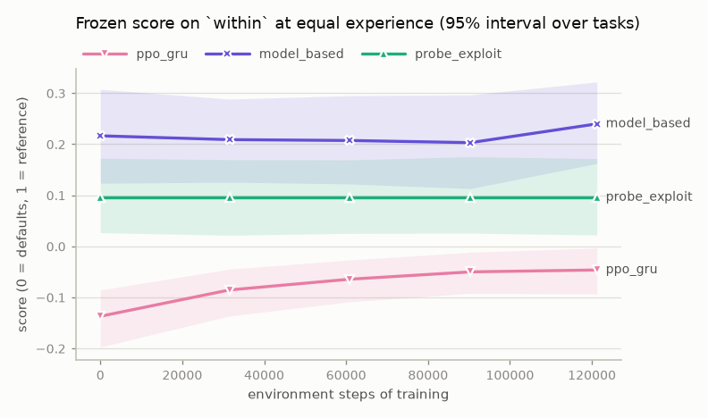

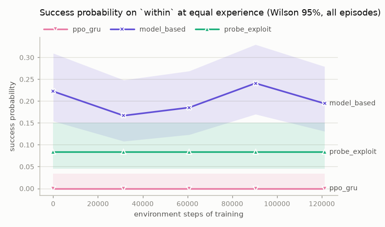

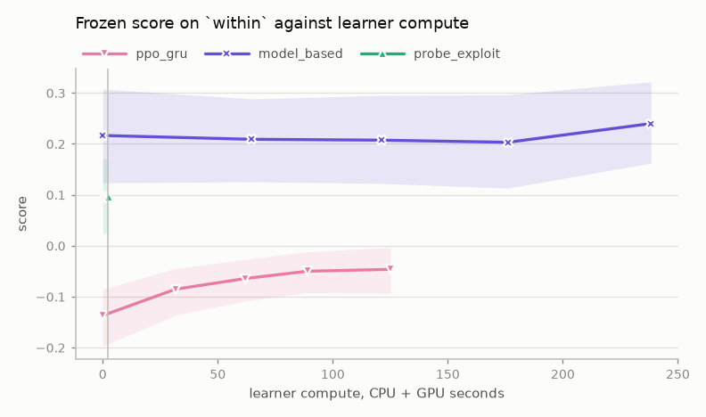

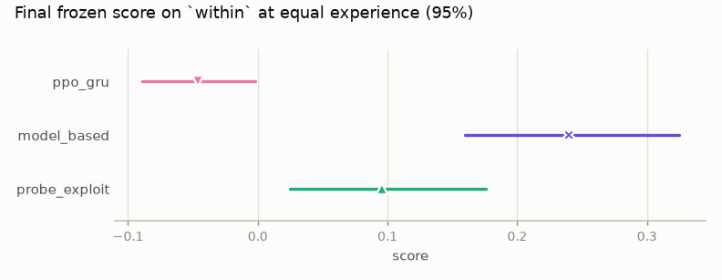

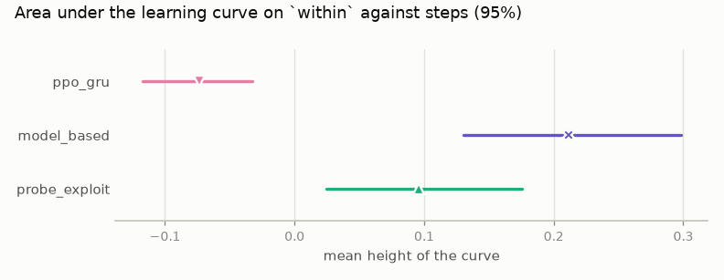

## Evaluation set `compositional`

| learner | final score [95% CI] | final IQM | final success [Wilson 95%, all episodes] | AUC score vs steps | AUC success vs steps | sd of the final score over seeds |
|---|---|---|---|---|---|---|
| ppo_gru | 0.028 [-0.020, 0.077] | 0.030 [-0.038, 0.092] | 0.000 [0.000, 0.176] | 0.004 [-0.033, 0.037] | 0.000 [0.000, 0.000] | 0.006 |
| model_based | 0.344 [0.114, 0.568] | 0.330 [0.055, 0.636] | 0.333 [0.163, 0.563] | 0.368 [0.144, 0.575] | 0.411 [0.146, 0.695] | 0.066 |
| probe_exploit | 0.224 [0.024, 0.453] | 0.176 [-0.026, 0.506] | 0.167 [0.058, 0.392] | 0.224 [0.024, 0.453] | 0.167 [0.000, 0.500] | 0.000 |

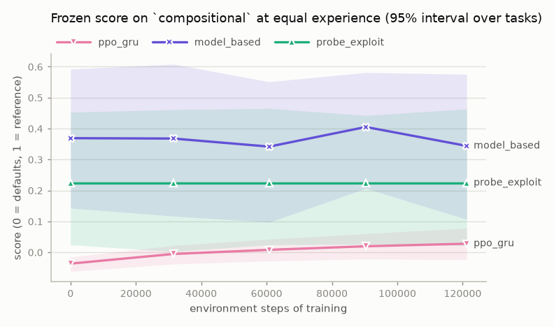

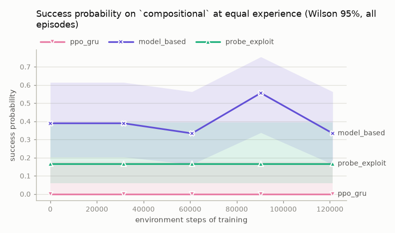

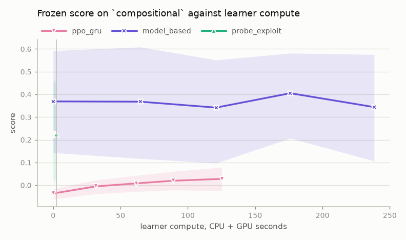

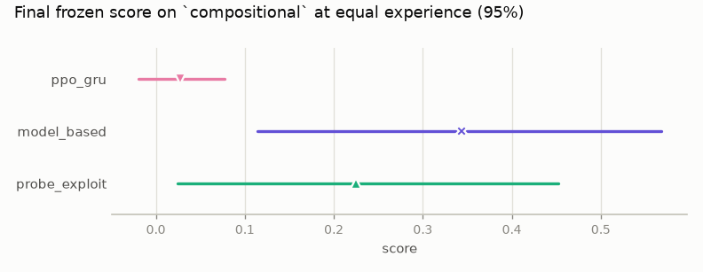

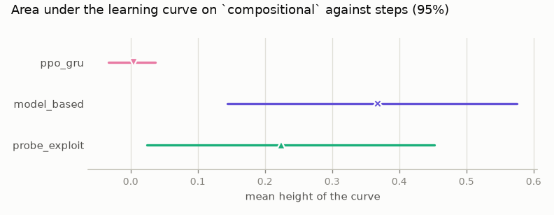

## Evaluation set `cross_impl`

| learner | final score [95% CI] | final IQM | final success [Wilson 95%, all episodes] | AUC score vs steps | AUC success vs steps | sd of the final score over seeds |
|---|---|---|---|---|---|---|
| ppo_gru | -0.734 [-1.070, -0.386] | -0.796 [-1.110, -0.291] | 0.000 [0.000, 0.176] | -0.709 [-1.027, -0.388] | 0.000 [0.000, 0.000] | 0.066 |
| model_based | -0.182 [-0.263, -0.125] | -0.159 [-0.272, -0.118] | 0.000 [0.000, 0.176] | -0.147 [-0.257, -0.050] | 0.000 [0.000, 0.000] | 0.060 |
| probe_exploit | 0.015 [-0.255, 0.264] | 0.051 [-0.276, 0.311] | 0.000 [0.000, 0.176] | 0.015 [-0.255, 0.264] | 0.000 [0.000, 0.000] | 0.000 |

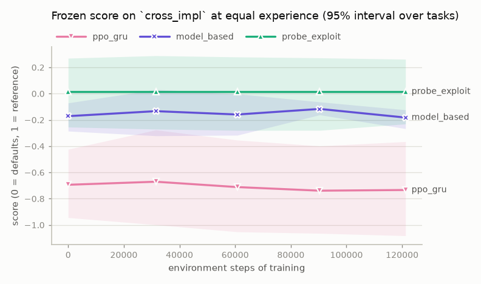

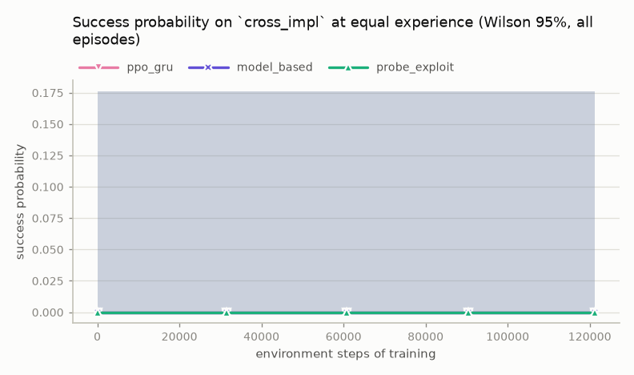

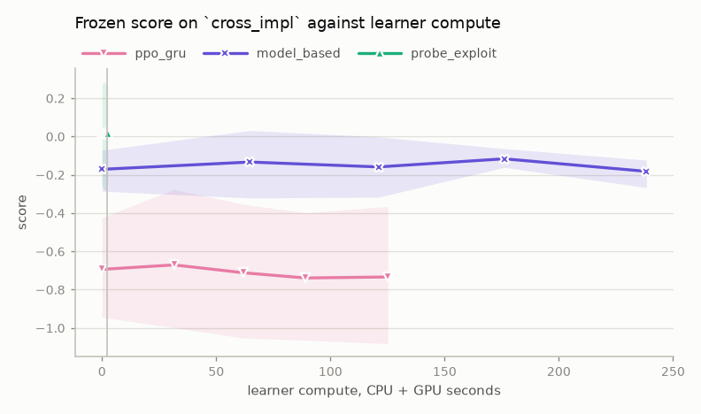

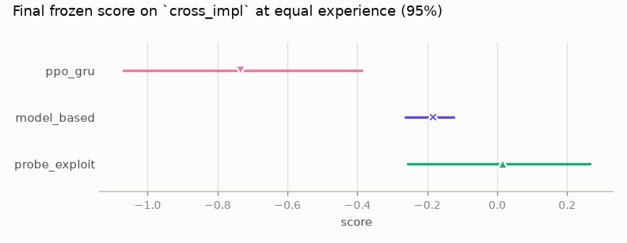

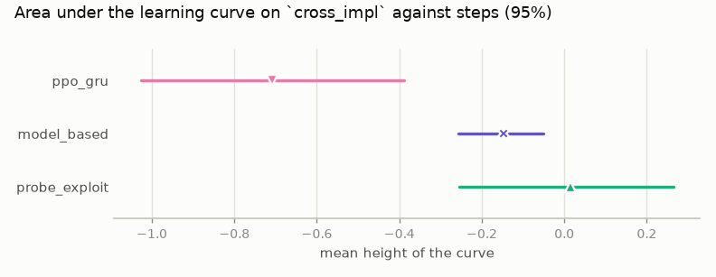

## Evaluation set `structural`

| learner | final score [95% CI] | final IQM | final success [Wilson 95%, all episodes] | AUC score vs steps | AUC success vs steps | sd of the final score over seeds |
|---|---|---|---|---|---|---|
| ppo_gru | 0.044 [-0.062, 0.146] | 0.020 [-0.077, 0.170] | 0.028 [0.005, 0.142] | -0.025 [-0.111, 0.051] | 0.010 [0.000, 0.031] | 0.014 |
| model_based | 0.271 [0.096, 0.446] | 0.238 [-0.022, 0.555] | 0.361 [0.225, 0.524] | 0.258 [0.089, 0.426] | 0.327 [0.129, 0.532] | 0.041 |
| probe_exploit | 0.248 [0.062, 0.443] | 0.166 [-0.025, 0.518] | 0.333 [0.202, 0.497] | 0.248 [0.062, 0.443] | 0.333 [0.083, 0.583] | 0.000 |

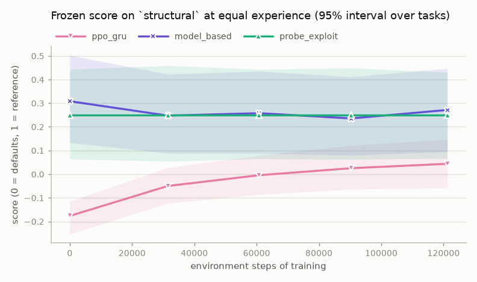

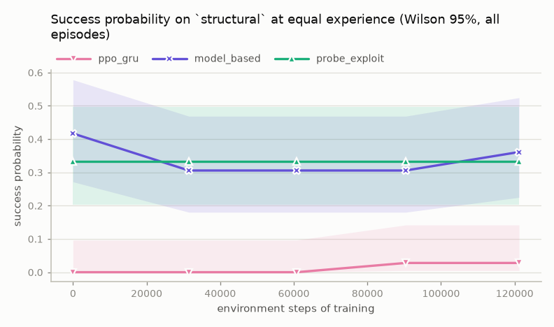

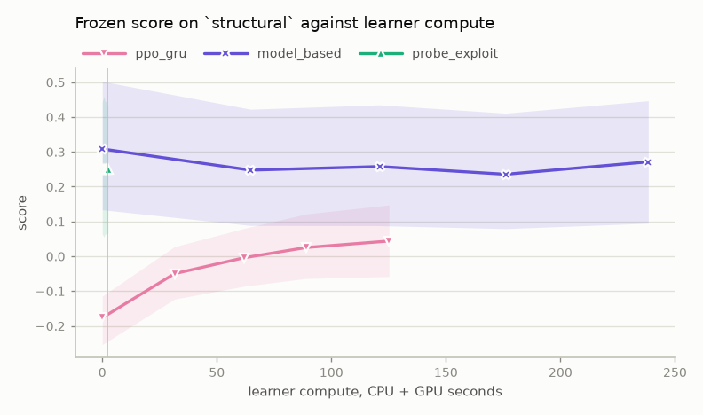

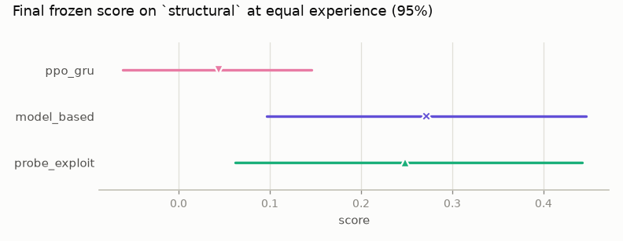

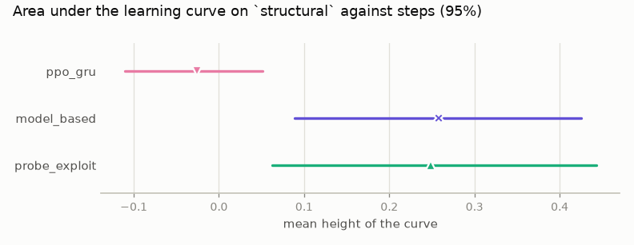

## Equal compute

Every learner is read at 2.279 s of learner compute (the smallest total any run used, so nobody is extrapolated).

| learner | total compute s | score on within at the budget | score on compositional at the budget | score on cross_impl at the budget | score on structural at the budget | env steps it had used by then |
|---|---|---|---|---|---|---|
| ppo_gru | 125.161 | -0.133 [-0.193, -0.083] | -0.034 [-0.059, -0.014] | -0.693 [-0.957, -0.417] | -0.167 [-0.243, -0.108] | 2,276 |
| model_based | 238.332 | 0.216 [0.125, 0.307] | 0.369 [0.141, 0.592] | -0.170 [-0.285, -0.063] | 0.306 [0.111, 0.496] | 1,120 |
| probe_exploit | 2.495 | 0.096 [0.025, 0.176] | 0.224 [0.024, 0.453] | 0.015 [-0.255, 0.264] | 0.248 [0.062, 0.443] | 110,860 |

## Costs (mean per run)

| learner | env steps | updates | train CPU s | infer CPU s | train GPU s | infer GPU s | env sim s | infer tokens | search evals | sim cost (cents) | sim net (cents) |
|---|---|---|---|---|---|---|---|---|---|---|---|
| ppo_gru | 121,216 | 420 | 107.78 | 17.38 | 0.00 | 0.00 | 101.65 | 0.00 | 0.00 | 350,100,680 | -61,471,398 |
| model_based | 121,216 | 992 | 170.18 | 68.16 | 0.00 | 0.00 | 99.21 | 0.00 | 2,700,846 | 554,316,942 | 159,433,127 |
| probe_exploit | 121,216 | 0.00 | 0.04 | 2.46 | 0.00 | 0.00 | 71.26 | 0.00 | 0.00 | 340,112,415 | 97,969,967 |

## Paired statistics

Paired differences (a minus b, per task; sign-flip permutation p; Holm-adjusted over the 40 comparisons of this table; significant at 0.05):

| quantity | set | a | b | a - b [95% CI] | p | p (Holm) | better | tasks |
|---|---|---|---|---|---|---|---|---|
| final_score@equal_steps | within | ppo_gru | probe_exploit | -0.142 [-0.198, -0.090] | <0.001 | 0.004 | probe_exploit | 36 |
| final_score@equal_steps | within | model_based | probe_exploit | 0.144 [0.081, 0.211] | <0.001 | 0.004 | model_based | 36 |
| final_success@equal_steps | within | ppo_gru | probe_exploit | -0.083 [-0.194, 0.000] | 0.260 | 1.000 | not distinguishable | 36 |
| final_success@equal_steps | within | model_based | probe_exploit | 0.111 [0.037, 0.194] | 0.013 | 0.390 | not distinguishable | 36 |
| auc_score_vs_steps | within | ppo_gru | probe_exploit | -0.169 [-0.232, -0.113] | <0.001 | 0.004 | probe_exploit | 36 |
| auc_score_vs_steps | within | model_based | probe_exploit | 0.116 [0.062, 0.171] | <0.001 | 0.004 | model_based | 36 |
| auc_success_vs_steps | within | ppo_gru | probe_exploit | -0.083 [-0.194, 0.000] | 0.260 | 1.000 | not distinguishable | 36 |
| auc_success_vs_steps | within | model_based | probe_exploit | 0.117 [0.034, 0.207] | 0.008 | 0.263 | not distinguishable | 36 |
| score@equal_compute | within | ppo_gru | probe_exploit | -0.229 [-0.309, -0.162] | <0.001 | 0.004 | probe_exploit | 36 |
| score@equal_compute | within | model_based | probe_exploit | 0.120 [0.059, 0.183] | <0.001 | 0.007 | model_based | 36 |
| final_score@equal_steps | compositional | ppo_gru | probe_exploit | -0.197 [-0.374, -0.044] | 0.031 | 0.906 | not distinguishable | 6 |
| final_score@equal_steps | compositional | model_based | probe_exploit | 0.120 [0.038, 0.205] | 0.062 | 1.000 | not distinguishable | 6 |
| final_success@equal_steps | compositional | ppo_gru | probe_exploit | -0.167 [-0.500, 0.000] | 1.000 | 1.000 | not distinguishable | 6 |
| final_success@equal_steps | compositional | model_based | probe_exploit | 0.167 [0.056, 0.278] | 0.250 | 1.000 | not distinguishable | 6 |
| auc_score_vs_steps | compositional | ppo_gru | probe_exploit | -0.220 [-0.413, -0.052] | 0.031 | 0.906 | not distinguishable | 6 |
| auc_score_vs_steps | compositional | model_based | probe_exploit | 0.144 [0.050, 0.247] | 0.031 | 0.906 | not distinguishable | 6 |
| auc_success_vs_steps | compositional | ppo_gru | probe_exploit | -0.167 [-0.500, 0.000] | 1.000 | 1.000 | not distinguishable | 6 |
| auc_success_vs_steps | compositional | model_based | probe_exploit | 0.244 [0.049, 0.467] | 0.125 | 1.000 | not distinguishable | 6 |
| score@equal_compute | compositional | ppo_gru | probe_exploit | -0.259 [-0.473, -0.071] | 0.031 | 0.906 | not distinguishable | 6 |
| score@equal_compute | compositional | model_based | probe_exploit | 0.144 [0.045, 0.253] | 0.031 | 0.906 | not distinguishable | 6 |
| final_score@equal_steps | cross_impl | ppo_gru | probe_exploit | -0.749 [-0.964, -0.547] | 0.031 | 0.906 | not distinguishable | 6 |
| final_score@equal_steps | cross_impl | model_based | probe_exploit | -0.198 [-0.415, 0.048] | 0.188 | 1.000 | not distinguishable | 6 |
| final_success@equal_steps | cross_impl | ppo_gru | probe_exploit | 0.000 [0.000, 0.000] | 1.000 | 1.000 | not distinguishable | 6 |
| final_success@equal_steps | cross_impl | model_based | probe_exploit | 0.000 [0.000, 0.000] | 1.000 | 1.000 | not distinguishable | 6 |
| auc_score_vs_steps | cross_impl | ppo_gru | probe_exploit | -0.724 [-0.899, -0.542] | 0.031 | 0.906 | not distinguishable | 6 |
| auc_score_vs_steps | cross_impl | model_based | probe_exploit | -0.162 [-0.365, 0.071] | 0.281 | 1.000 | not distinguishable | 6 |
| auc_success_vs_steps | cross_impl | ppo_gru | probe_exploit | 0.000 [0.000, 0.000] | 1.000 | 1.000 | not distinguishable | 6 |
| auc_success_vs_steps | cross_impl | model_based | probe_exploit | 0.000 [0.000, 0.000] | 1.000 | 1.000 | not distinguishable | 6 |
| score@equal_compute | cross_impl | ppo_gru | probe_exploit | -0.708 [-0.862, -0.538] | 0.031 | 0.906 | not distinguishable | 6 |
| score@equal_compute | cross_impl | model_based | probe_exploit | -0.185 [-0.411, 0.101] | 0.281 | 1.000 | not distinguishable | 6 |
| final_score@equal_steps | structural | ppo_gru | probe_exploit | -0.205 [-0.339, -0.085] | 0.007 | 0.219 | not distinguishable | 12 |
| final_score@equal_steps | structural | model_based | probe_exploit | 0.023 [-0.079, 0.174] | 0.924 | 1.000 | not distinguishable | 12 |
| final_success@equal_steps | structural | ppo_gru | probe_exploit | -0.306 [-0.556, -0.083] | 0.125 | 1.000 | not distinguishable | 12 |
| final_success@equal_steps | structural | model_based | probe_exploit | 0.028 [-0.194, 0.278] | 1.000 | 1.000 | not distinguishable | 12 |
| auc_score_vs_steps | structural | ppo_gru | probe_exploit | -0.274 [-0.426, -0.142] | <0.001 | 0.017 | probe_exploit | 12 |
| auc_score_vs_steps | structural | model_based | probe_exploit | 0.009 [-0.094, 0.142] | 0.902 | 1.000 | not distinguishable | 12 |
| auc_success_vs_steps | structural | ppo_gru | probe_exploit | -0.323 [-0.573, -0.083] | 0.125 | 1.000 | not distinguishable | 12 |
| auc_success_vs_steps | structural | model_based | probe_exploit | -0.007 [-0.202, 0.212] | 0.938 | 1.000 | not distinguishable | 12 |
| score@equal_compute | structural | ppo_gru | probe_exploit | -0.416 [-0.602, -0.246] | <0.001 | 0.017 | probe_exploit | 12 |
| score@equal_compute | structural | model_based | probe_exploit | 0.058 [-0.053, 0.212] | 0.568 | 1.000 | not distinguishable | 12 |

## What the records establish about failures

**ppo_gru on within**: 108 of 108 episodes failed. never_found: 108.
- 108 of 108 failed episodes: never_found (e.g. abm_congestion:1000000: moved levers on 120 of 120 ticks (120 changes) and never ran at the objective rate: best segment 0.01 of the reference)
- against probe_exploit on the same tasks: -0.142 [-0.198, -0.090], p=0.0001 (Holm 0.004): worse than the reference

**ppo_gru on compositional**: 18 of 18 episodes failed. never_found: 18.
- 18 of 18 failed episodes: never_found (e.g. scm_delay_gate:1000000: moved levers on 144 of 144 ticks (144 changes) and never ran at the objective rate: best segment -0.01 of the reference)
- against probe_exploit on the same tasks: -0.197 [-0.374, -0.044], p=0.0312 (Holm 0.906): no better than the reference (difference not distinguishable from zero after correction)

**ppo_gru on cross_impl**: 18 of 18 episodes failed. never_found: 17; went_broke: 1.
- 17 of 18 failed episodes: never_found (e.g. tech_pipeline:1000000: moved levers on 144 of 144 ticks (144 changes) and never ran at the objective rate: best segment 0.14 of the reference)
- 1 of 18 failed episodes: went_broke (e.g. tech_pipeline:1000004: moved levers and could not pay in 17 of 144 ticks (1 at fallback settings, 16 idle); balance at the end 51 cents)
- against probe_exploit on the same tasks: -0.749 [-0.964, -0.547], p=0.0312 (Holm 0.906): no better than the reference (difference not distinguishable from zero after correction)

**ppo_gru on structural**: 35 of 36 episodes failed. never_found: 35.
- 35 of 35 failed episodes: never_found (e.g. abm_trust_gate:1000000: moved levers on 160 of 160 ticks (160 changes) and never ran at the objective rate: best segment -0.08 of the reference)
- against probe_exploit on the same tasks: -0.205 [-0.339, -0.085], p=0.00684 (Holm 0.219): no better than the reference (difference not distinguishable from zero after correction)

**model_based on within**: 87 of 108 episodes failed. never_found: 77; found_late: 8; found_and_lost: 2.
- 77 of 87 failed episodes: never_found (e.g. abm_congestion:1000000: moved levers on 118 of 120 ticks (47 changes) and never ran at the objective rate: best segment -0.03 of the reference)
- 8 of 87 failed episodes: found_late (e.g. scm_delay:1000003: ran at 0.53 of the reference in the last segment (objective rate 0.50), first reached in segment 2 of 4: too late for the episode total)
- 2 of 87 failed episodes: found_and_lost (e.g. abm_utility:1000000: ran at 0.50 of the reference in segment 2 of 4 and at 0.23 in the last, after it changed its own settings)
- against probe_exploit on the same tasks: +0.144 [+0.081, +0.211], p=0.0001 (Holm 0.004): better than the reference

**model_based on compositional**: 12 of 18 episodes failed. never_found: 9; found_late: 3.
- 9 of 12 failed episodes: never_found (e.g. scm_delay_gate:1000000: moved levers on 142 of 144 ticks (40 changes) and never ran at the objective rate: best segment -0.01 of the reference)
- 3 of 12 failed episodes: found_late (e.g. scm_delay_gate:1000002: ran at 0.51 of the reference in the last segment (objective rate 0.50), first reached in segment 2 of 4: too late for the episode total)
- against probe_exploit on the same tasks: +0.120 [+0.038, +0.205], p=0.0625 (Holm 1): no better than the reference (difference not distinguishable from zero after correction)

**model_based on cross_impl**: 18 of 18 episodes failed. never_found: 17; found_late: 1.
- 17 of 18 failed episodes: never_found (e.g. tech_pipeline:1000000: moved levers on 142 of 144 ticks (56 changes) and never ran at the objective rate: best segment 0.44 of the reference)
- 1 of 18 failed episodes: found_late (e.g. tech_pipeline:1000003: ran at 0.61 of the reference in the last segment (objective rate 0.50), first reached in segment 4 of 4: too late for the episode total)
- against probe_exploit on the same tasks: -0.198 [-0.415, +0.048], p=0.188 (Holm 1): no better than the reference (difference not distinguishable from zero after correction)

**model_based on structural**: 23 of 36 episodes failed. never_found: 20; found_late: 3.
- 20 of 23 failed episodes: never_found (e.g. abm_trust_gate:1000000: moved levers on 158 of 160 ticks (31 changes) and never ran at the objective rate: best segment 0.00 of the reference)
- 3 of 23 failed episodes: found_late (e.g. scm_invu:1000002: ran at 0.64 of the reference in the last segment (objective rate 0.50), first reached in segment 2 of 4: too late for the episode total)
- against probe_exploit on the same tasks: +0.023 [-0.079, +0.174], p=0.924 (Holm 1): no better than the reference (difference not distinguishable from zero after correction)

**probe_exploit on within**: 99 of 108 episodes failed. never_found: 93; found_late: 6.
- 93 of 99 failed episodes: never_found (e.g. abm_congestion:1000000: moved levers on 116 of 120 ticks (8 changes) and never ran at the objective rate: best segment 0.10 of the reference)
- 6 of 99 failed episodes: found_late (e.g. scm_additive:1000005: ran at 0.58 of the reference in the last segment (objective rate 0.50), first reached in segment 2 of 4: too late for the episode total)

**probe_exploit on compositional**: 15 of 18 episodes failed. never_found: 12; found_late: 3.
- 12 of 15 failed episodes: never_found (e.g. scm_delay_gate:1000000: moved levers on 140 of 144 ticks (8 changes) and never ran at the objective rate: best segment 0.00 of the reference)
- 3 of 15 failed episodes: found_late (e.g. scm_delay_gate:1000005: ran at 0.53 of the reference in the last segment (objective rate 0.50), first reached in segment 2 of 4: too late for the episode total)

**probe_exploit on cross_impl**: 18 of 18 episodes failed. found_and_lost: 9; never_found: 9.
- 9 of 18 failed episodes: found_and_lost (e.g. tech_pipeline:1000000: ran at 0.61 of the reference in segment 3 of 4 and at 0.46 in the last, while it held its settings (the world changed under them))
- 9 of 18 failed episodes: never_found (e.g. tech_pipeline:1000003: moved levers on 44 of 144 ticks (12 changes) and never ran at the objective rate: best segment -0.02 of the reference)

**probe_exploit on structural**: 24 of 36 episodes failed. never_found: 21; found_late: 3.
- 21 of 24 failed episodes: never_found (e.g. abm_trust_gate:1000000: moved levers on 24 of 160 ticks (7 changes) and never ran at the objective rate: best segment 0.00 of the reference)
- 3 of 24 failed episodes: found_late (e.g. scm_invu:1000002: ran at 0.61 of the reference in the last segment (objective rate 0.50), first reached in segment 2 of 4: too late for the episode total)
