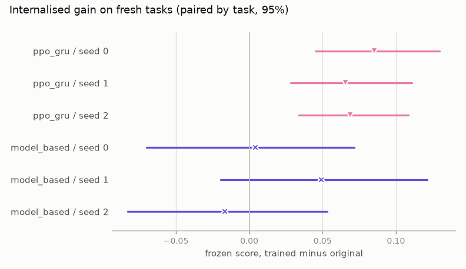
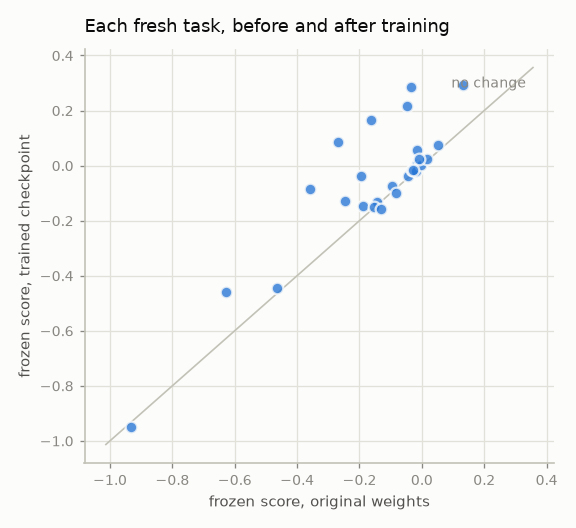
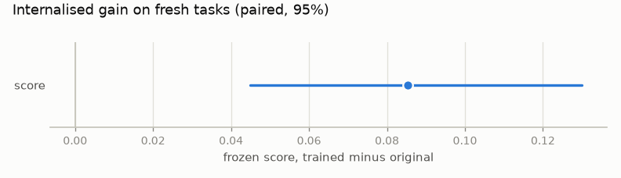
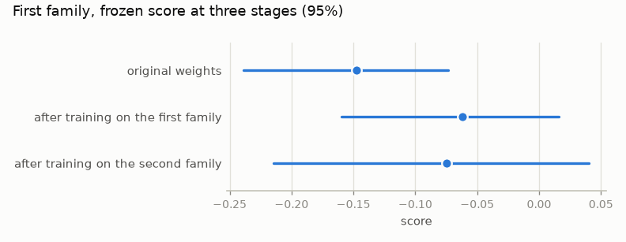
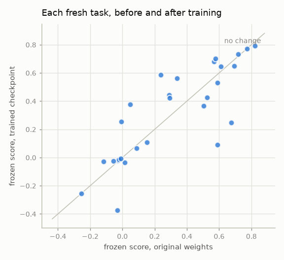
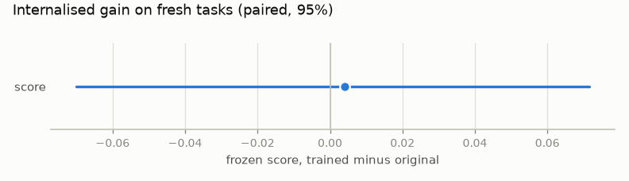
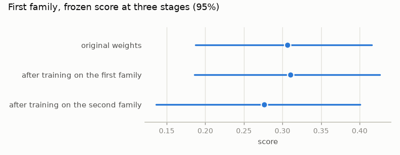

# Parametric internalisation: final

Measured under task definition `task/2`, mechanism contract `mech/1`, protocol schema `crucible.research.protocols/1`.

| learner | seed | verdict | original score | trained score | paired gain [95% CI] | p | updates | env interactions | compute s | valid |
|---|---|---|---|---|---|---|---|---|---|---|
| ppo_gru | 0 | internalised | -0.147 [-0.239, -0.073] | -0.062 [-0.160, 0.016] | 0.085 [0.045, 0.130] | <0.001 | 220 | 60,672 | 62.49 | yes |
| ppo_gru | 1 | internalised | -0.153 [-0.254, -0.071] | -0.087 [-0.199, 0.002] | 0.065 [0.028, 0.111] | <0.001 | 220 | 60,672 | 64.46 | yes |
| ppo_gru | 2 | internalised | -0.145 [-0.243, -0.068] | -0.076 [-0.187, 0.009] | 0.069 [0.034, 0.108] | <0.001 | 220 | 60,672 | 60.97 | yes |
| model_based | 0 | no_gain_detected | 0.306 [0.187, 0.416] | 0.310 [0.186, 0.426] | 0.004 [-0.070, 0.072] | 0.912 | 544 | 60,672 | 144.50 | yes |
| model_based | 1 | no_gain_detected | 0.256 [0.116, 0.381] | 0.305 [0.165, 0.429] | 0.049 [-0.020, 0.121] | 0.190 | 544 | 60,672 | 141.97 | yes |
| model_based | 2 | no_gain_detected | 0.259 [0.115, 0.392] | 0.242 [0.095, 0.385] | -0.017 [-0.083, 0.053] | 0.648 | 544 | 60,672 | 147.96 | yes |

## Parametric internalisation: ppo_gru (seed 0)

**Verdict: internalised.** Frozen score on 28 fresh tasks: original weights -0.147 [-0.239, -0.073], trained checkpoint -0.062 [-0.160, 0.016]; paired gain 0.085 [0.045, 0.130], p=<0.001, better on 86% of tasks. Success probability 0.000 [0.000, 0.121] -> 0.000 [0.000, 0.121].

| step | what | recorded |
|---|---|---|
| 1 | evaluate original weights | score -0.147 [-0.239, -0.073]; state unchanged by evaluation: yes |
| 2 | learning interactions | 60,672 environment steps in 544 episodes on 544 tasks; inference 7.91 CPU s, 0 tokens, 0 search evaluations |
| 3 | update weights | 220 updates; training 54.59 CPU s, 0.00 GPU s |
| 4 | save checkpoint | hash 852e14c159f4 (structured, 460959 bytes); differs from the original: yes |
| 5 | clear task context | a new learner from the factory, restored from the saved checkpoint; checkpoint round-trips: yes |
| 6 | disable retrieval | freeze(True); frozen flag set: yes |
| 7 | evaluate on fresh tasks | score -0.062 [-0.160, 0.016]; disjoint from the 544 training tasks by task id and mechanism fingerprint: yes; state unchanged by evaluation: yes; evaluation reproduces itself: yes |
| 8 | compare with original paired by task | score 0.085 [0.045, 0.130], success 0.000 [0.000, 0.000] |

| updates | environment interactions | training CPU s | training GPU s | inference CPU s | inference GPU s | environment simulation s | tokens | search evaluations |
|---|---|---|---|---|---|---|---|---|
| 220 | 60,672 | 54.59 | 0.00 | 7.91 | 0.00 | 10.06 | 0 | 0 |

Trained checkpoint by relation of the family to the training set:

| relation | episodes | score [95% CI] | success [Wilson] |
|---|---|---|---|
| compositional | 4 | -0.003 [-0.051, 0.040] ~ | 0.000 [0.000, 0.490] ~ |
| cross_impl | 4 | -0.407 [-0.745, -0.108] ~ | 0.000 [0.000, 0.490] ~ |
| structural | 8 | -0.028 [-0.184, 0.119] | 0.000 [0.000, 0.324] |
| within | 12 | 0.010 [-0.044, 0.078] | 0.000 [0.000, 0.242] |

### Retention

After 31,360 further environment steps on a second family (140 updates), the first family was evaluated again: 84.7% [0.5, 147.1] of the first gain is kept; forgetting (score lost) 0.013 [-0.037, 0.079].

| first family, frozen score | mean [95% CI] |
|---|---|
| original weights | -0.147 [-0.239, -0.073] |
| after training on the first family | -0.062 [-0.160, 0.016] |
| after training on the second family | -0.075 [-0.214, 0.040] |

## Parametric internalisation: model_based (seed 0)

**Verdict: no_gain_detected.** Frozen score on 28 fresh tasks: original weights 0.306 [0.187, 0.416], trained checkpoint 0.310 [0.186, 0.426]; paired gain 0.004 [-0.070, 0.072], p=0.912, better on 57% of tasks. Success probability 0.429 [0.265, 0.609] -> 0.357 [0.207, 0.542].

| step | what | recorded |
|---|---|---|
| 1 | evaluate original weights | score 0.306 [0.187, 0.416]; state unchanged by evaluation: yes |
| 2 | learning interactions | 60,672 environment steps in 544 episodes on 544 tasks; inference 36.05 CPU s, 0 tokens, 1,523,034 search evaluations |
| 3 | update weights | 544 updates; training 108.46 CPU s, 0.00 GPU s |
| 4 | save checkpoint | hash 8d58a3fe95dd (structured, 46123 bytes); differs from the original: yes |
| 5 | clear task context | a new learner from the factory, restored from the saved checkpoint; checkpoint round-trips: yes |
| 6 | disable retrieval | freeze(True); frozen flag set: yes |
| 7 | evaluate on fresh tasks | score 0.310 [0.186, 0.426]; disjoint from the 544 training tasks by task id and mechanism fingerprint: yes; state unchanged by evaluation: yes; evaluation reproduces itself: yes |
| 8 | compare with original paired by task | score 0.004 [-0.070, 0.072], success -0.071 [-0.250, 0.107] |

| updates | environment interactions | training CPU s | training GPU s | inference CPU s | inference GPU s | environment simulation s | tokens | search evaluations |
|---|---|---|---|---|---|---|---|---|
| 544 | 60,672 | 108.46 | 0.00 | 36.05 | 0.00 | 15.12 | 0 | 1,523,034 |

Trained checkpoint by relation of the family to the training set:

| relation | episodes | score [95% CI] | success [Wilson] |
|---|---|---|---|
| compositional | 4 | 0.437 [0.120, 0.685] ~ | 0.500 [0.150, 0.850] ~ |
| cross_impl | 4 | 0.080 [-0.218, 0.315] ~ | 0.000 [0.000, 0.490] ~ |
| structural | 8 | 0.270 [0.064, 0.521] | 0.375 [0.137, 0.694] |
| within | 12 | 0.372 [0.200, 0.529] | 0.417 [0.193, 0.680] |

### Retention

After 31,360 further environment steps on a second family (224 updates), the first family was evaluated again: kept fraction undefined (nothing was gained on the first family, so there is nothing to retain); forgetting (score lost) 0.034 [-0.012, 0.085].

| first family, frozen score | mean [95% CI] |
|---|---|
| original weights | 0.306 [0.187, 0.416] |
| after training on the first family | 0.310 [0.186, 0.426] |
| after training on the second family | 0.276 [0.136, 0.401] |

