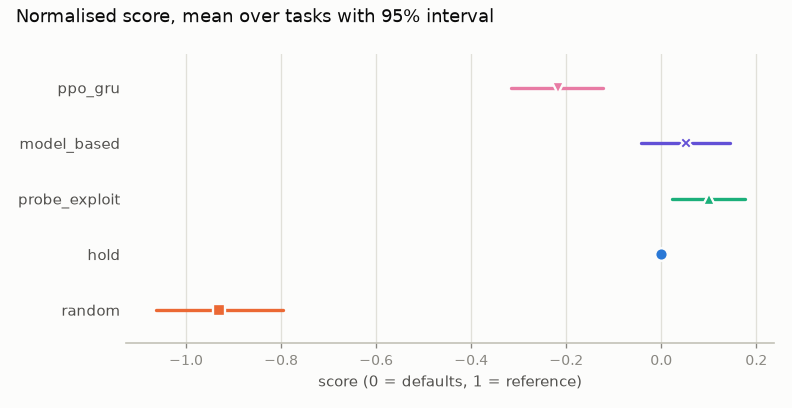
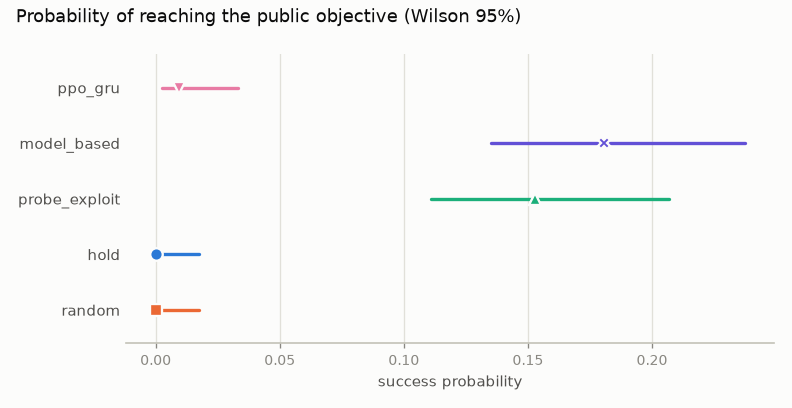
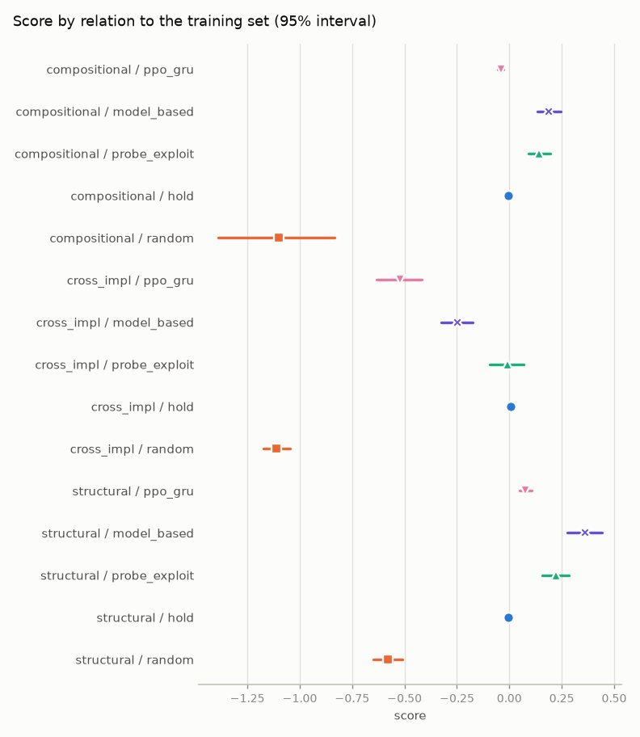
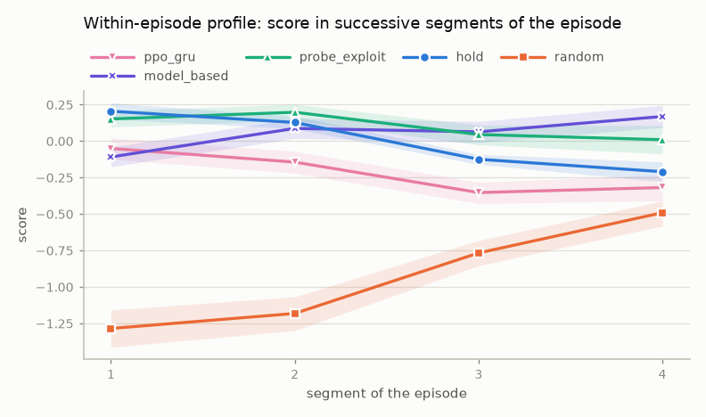

# Sealed test: final

> **SEALED TEST SET** `ow-final`, generation 1, access 1 of 1 (task definition task/2). Purpose stated at access: "final table of the Crucible 4.0 report; checkpoints of the equal-budget comparison (tag final), nothing tuned afterwards". Tasks are named by alias; seeds are not recorded.

Measured under task definition `task/2`, mechanism contract `mech/1`, protocol schema `crucible.research.protocols/1`.

72 tasks, families: abm_network_fx, abm_segments, scm_feedback, scm_regime, scm_stock_gate, tech_cascade, tech_contention, tech_lostwork, tech_redundant. Weights frozen, context reset at the start of every episode, one episode per task and learner seed, identical tasks for every learner. Score: 0 = the default settings left alone, 1 = the reference policy. Success: the public objective was reached. Intervals are over tasks.

| learner | seeds | score mean [95% CI] | score IQM [95% CI] | success [Wilson 95%] | late - early segment | infer CPU s | frozen state unchanged |
|---|---|---|---|---|---|---|---|
| ppo_gru | 3 | -0.217 [-0.317, -0.123] | -0.071 [-0.156, -0.024] | 0.009 [0.003, 0.033] | -0.268 [-0.374, -0.154] | 5.19 | yes |
| model_based | 3 | 0.052 [-0.042, 0.145] | 0.051 [-0.060, 0.166] | 0.181 [0.135, 0.237] | 0.278 [0.188, 0.371] | 24.39 | yes |
| probe_exploit | 3 | 0.101 [0.022, 0.175] | 0.082 [0.020, 0.167] | 0.153 [0.111, 0.207] | -0.142 [-0.270, -0.009] | 1.02 | yes |
| hold | 3 | -5.2e-04 [-0.007, 0.006] | 8.4e-04 [-0.004, 0.005] | 0.000 [0.000, 0.017] | -0.415 [-0.530, -0.298] | 0.03 | yes |
| random | 3 | -0.931 [-1.064, -0.796] | -0.880 [-1.019, -0.742] | 0.000 [0.000, 0.017] | 0.794 [0.644, 0.940] | 0.14 | yes |

Score by relation of the family to the training set (mean [95% CI], n episodes):

| learner | compositional | cross_impl | structural |
|---|---|---|---|
| ppo_gru | -0.041 [-0.054, -0.028] (n=48) | -0.524 [-0.632, -0.416] (n=96) | 0.076 [0.048, 0.106] (n=72) |
| model_based | 0.189 [0.135, 0.247] (n=48) | -0.248 [-0.325, -0.175] (n=96) | 0.363 [0.276, 0.442] (n=72) |
| probe_exploit | 0.141 [0.089, 0.197] (n=48) | -0.010 [-0.094, 0.067] (n=96) | 0.222 [0.158, 0.284] (n=72) |
| hold | -0.003 [-0.007, 4.4e-05] (n=48) | 0.006 [1.6e-05, 0.011] (n=96) | -0.007 [-0.015, 0.001] (n=72) |
| random | -1.100 [-1.389, -0.833] (n=48) | -1.111 [-1.175, -1.048] (n=96) | -0.580 [-0.650, -0.511] (n=72) |

Score by family (mean [95% CI], n episodes):

| learner | abm_network_fx | abm_segments | scm_feedback | scm_regime | scm_stock_gate | tech_cascade | tech_contention | tech_lostwork | tech_redundant |
|---|---|---|---|---|---|---|---|---|---|
| ppo_gru | -0.039 [-0.044, -0.035] (n=24) | -0.069 [-0.085, -0.056] (n=24) | 0.099 [0.062, 0.140] (n=24) | 0.168 [0.116, 0.227] (n=24) | -0.013 [-0.027, 0.002] (n=24) | -0.384 [-0.550, -0.220] (n=24) | -1.214 [-1.282, -1.153] (n=24) | -7.7e-04 [-0.109, 0.118] (n=24) | -0.495 [-0.576, -0.417] (n=24) |
| model_based | -0.014 [-0.017, -0.011] (n=24) | 0.065 [0.040, 0.091] (n=24) | 0.626 [0.545, 0.697] (n=24) | 0.477 [0.287, 0.606] (n=24) | 0.313 [0.229, 0.401] (n=24) | -0.453 [-0.571, -0.336] (n=24) | -0.386 [-0.498, -0.265] (n=24) | 0.201 [0.126, 0.272] (n=24) | -0.355 [-0.443, -0.274] (n=24) |
| probe_exploit | -0.010 [-0.011, -0.009] (n=24) | -0.001 [-0.007, 0.004] (n=24) | 0.227 [0.098, 0.346] (n=24) | 0.449 [0.393, 0.505] (n=24) | 0.284 [0.212, 0.354] (n=24) | -0.180 [-0.284, -0.081] (n=24) | -0.184 [-0.328, -0.039] (n=24) | 0.496 [0.414, 0.569] (n=24) | -0.173 [-0.265, -0.092] (n=24) |
| hold | 4.1e-05 [-4.4e-05, 1.3e-04] (n=24) | -6.8e-04 [-0.001, 9.6e-05] (n=24) | -0.034 [-0.049, -0.018] (n=24) | 0.014 [0.004, 0.025] (n=24) | -0.006 [-0.014, 6.9e-04] (n=24) | -0.007 [-0.016, 0.002] (n=24) | 0.011 [0.004, 0.018] (n=24) | 0.012 [-0.001, 0.023] (n=24) | 0.008 [-0.004, 0.019] (n=24) |
| random | -0.858 [-0.923, -0.791] (n=24) | -1.955 [-2.220, -1.709] (n=24) | -0.521 [-0.583, -0.460] (n=24) | -0.362 [-0.493, -0.253] (n=24) | -0.245 [-0.290, -0.202] (n=24) | -0.909 [-0.976, -0.839] (n=24) | -1.335 [-1.399, -1.275] (n=24) | -0.812 [-0.856, -0.774] (n=24) | -1.386 [-1.460, -1.310] (n=24) |

| learner | segment 1 | segment 2 | segment 3 | segment 4 |
|---|---|---|---|---|
| ppo_gru | -0.050 [-0.125, 0.022] | -0.144 [-0.220, -0.070] | -0.353 [-0.428, -0.284] | -0.319 [-0.409, -0.232] |
| model_based | -0.109 [-0.176, -0.041] | 0.087 [0.019, 0.155] | 0.063 [-0.009, 0.135] | 0.169 [0.093, 0.244] |
| probe_exploit | 0.152 [0.097, 0.208] | 0.198 [0.141, 0.252] | 0.045 [-0.026, 0.110] | 0.009 [-0.087, 0.107] |
| hold | 0.205 [0.152, 0.260] | 0.128 [0.085, 0.171] | -0.125 [-0.159, -0.091] | -0.210 [-0.279, -0.142] |
| random | -1.285 [-1.413, -1.158] | -1.182 [-1.300, -1.068] | -0.767 [-0.855, -0.682] | -0.491 [-0.583, -0.410] |

Paired differences (a minus b, per task; sign-flip permutation p; Holm-adjusted over the 8 comparisons of this table; significant at 0.05):

| quantity | set | a | b | a - b [95% CI] | p | p (Holm) | better | tasks |
|---|---|---|---|---|---|---|---|---|
| score | tasks | ppo_gru | probe_exploit | -0.317 [-0.407, -0.233] | <0.001 | <0.001 | probe_exploit | 72 |
| score | tasks | model_based | probe_exploit | -0.048 [-0.115, 0.021] | 0.192 | 0.383 | not distinguishable | 72 |
| score | tasks | hold | probe_exploit | -0.101 [-0.175, -0.022] | 0.014 | 0.042 | probe_exploit | 72 |
| score | tasks | random | probe_exploit | -1.032 [-1.148, -0.906] | <0.001 | <0.001 | probe_exploit | 72 |
| success | tasks | ppo_gru | probe_exploit | -0.144 [-0.222, -0.065] | 0.001 | 0.007 | probe_exploit | 72 |
| success | tasks | model_based | probe_exploit | 0.028 [-0.074, 0.134] | 0.659 | 0.659 | not distinguishable | 72 |
| success | tasks | hold | probe_exploit | -0.153 [-0.236, -0.069] | 0.001 | 0.007 | probe_exploit | 72 |
| success | tasks | random | probe_exploit | -0.153 [-0.236, -0.069] | 0.001 | 0.007 | probe_exploit | 72 |

## What the episode records establish about failures

**ppo_gru**: 214 of 216 episodes failed. never_found: 172; found_and_lost: 32; found_late: 7; went_broke: 3.
- 172 of 214 failed episodes: never_found (e.g. sealed/ow-final/g1/abm_network_fx/0: moved levers on 160 of 160 ticks (160 changes) and never ran at the objective rate: best segment -0.02 of the reference)
- 32 of 214 failed episodes: found_and_lost (e.g. sealed/ow-final/g1/scm_regime/2: ran at 0.72 of the reference in segment 1 of 4 and at -0.32 in the last, after it changed its own settings)
- 7 of 214 failed episodes: found_late (e.g. sealed/ow-final/g1/scm_regime/3: ran at 1.74 of the reference in the last segment (objective rate 0.50), first reached in segment 4 of 4: too late for the episode total)
- 3 of 214 failed episodes: went_broke (e.g. sealed/ow-final/g1/tech_cascade/5: moved levers and could not pay in 18 of 144 ticks (0 at fallback settings, 18 idle); balance at the end 124 cents)
- against probe_exploit on the same tasks: -0.317 [-0.407, -0.233], p=0.0001 (Holm 0.0008): worse than the reference

**model_based**: 177 of 216 episodes failed. never_found: 140; found_late: 29; found_and_lost: 8.
- 140 of 177 failed episodes: never_found (e.g. sealed/ow-final/g1/abm_network_fx/0: moved levers on 158 of 160 ticks (53 changes) and never ran at the objective rate: best segment 0.00 of the reference)
- 29 of 177 failed episodes: found_late (e.g. sealed/ow-final/g1/scm_regime/3: ran at 2.89 of the reference in the last segment (objective rate 0.50), first reached in segment 3 of 4: too late for the episode total)
- 8 of 177 failed episodes: found_and_lost (e.g. sealed/ow-final/g1/scm_regime/2: ran at 0.66 of the reference in segment 2 of 4 and at 0.00 in the last, after it changed its own settings)
- against probe_exploit on the same tasks: -0.048 [-0.115, +0.021], p=0.192 (Holm 0.383): no better than the reference (difference not distinguishable from zero after correction)

**probe_exploit**: 183 of 216 episodes failed. never_found: 108; found_and_lost: 51; found_late: 24.
- 108 of 183 failed episodes: never_found (e.g. sealed/ow-final/g1/abm_network_fx/0: moved levers on 156 of 160 ticks (7 changes) and never ran at the objective rate: best segment 0.00 of the reference)
- 51 of 183 failed episodes: found_and_lost (e.g. sealed/ow-final/g1/scm_regime/4: ran at 0.58 of the reference in segment 1 of 4 and at -0.06 in the last, after it changed its own settings)
- 24 of 183 failed episodes: found_late (e.g. sealed/ow-final/g1/scm_feedback/3: ran at 0.56 of the reference in the last segment (objective rate 0.50), first reached in segment 4 of 4: too late for the episode total)

**hold**: 216 of 216 episodes failed. never_touched: 216.
- 216 of 216 failed episodes: never_touched (e.g. sealed/ow-final/g1/abm_network_fx/0: no lever was ever moved from its starting setting)
- against probe_exploit on the same tasks: -0.101 [-0.175, -0.022], p=0.0139 (Holm 0.0417): worse than the reference

**random**: 216 of 216 episodes failed. never_found: 137; went_broke: 76; found_late: 3.
- 137 of 216 failed episodes: never_found (e.g. sealed/ow-final/g1/abm_network_fx/0: moved levers on 160 of 160 ticks (160 changes) and never ran at the objective rate: best segment -0.74 of the reference)
- 76 of 216 failed episodes: went_broke (e.g. sealed/ow-final/g1/scm_feedback/3: moved levers and could not pay in 19 of 144 ticks (19 at fallback settings, 0 idle); balance at the end 7619 cents)
- 3 of 216 failed episodes: found_late (e.g. sealed/ow-final/g1/scm_regime/3: ran at 0.84 of the reference in the last segment (objective rate 0.50), first reached in segment 4 of 4: too late for the episode total)
- against probe_exploit on the same tasks: -1.032 [-1.148, -0.906], p=0.0001 (Holm 0.0008): worse than the reference
