# The three timescales of learning: final

Measured under task definition `task/2`, mechanism contract `mech/1`, protocol schema `crucible.research.protocols/1`.

| learner | seed | fast: what context carries (trained) | parametric: frozen gain | meta: gain in what context carries | parametric gain without context | updates |
|---|---|---|---|---|---|---|
| ppo_gru | 0 | 0.954 [0.478, 1.551] (present) | 0.078 [0.052, 0.106] (present) | -0.164 [-0.545, 0.070]  | 0.242 [0.008, 0.629] | 220 |
| ppo_gru | 1 | 1.308 [0.626, 2.207] (present) | 0.088 [0.050, 0.127] (present) | -0.075 [-0.355, 0.094]  | 0.163 [0.011, 0.433] | 220 |
| model_based | 0 | 0.215 [0.132, 0.308] (present) | -2.3e-04 [-0.040, 0.042]  | -2.3e-04 [-0.040, 0.042]  | 0.000 [0.000, 0.000] | 496 |
| model_based | 1 | 0.248 [0.159, 0.342] (present) | 0.066 [0.004, 0.128]  | 0.066 [0.004, 0.128]  | 0.000 [0.000, 0.000] | 496 |

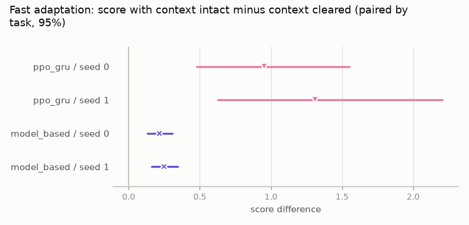

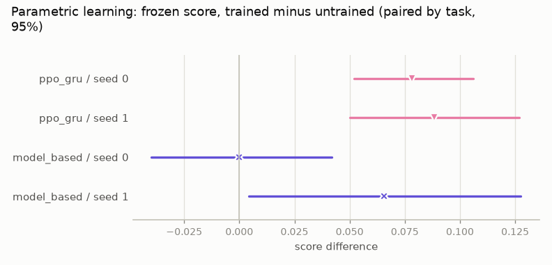

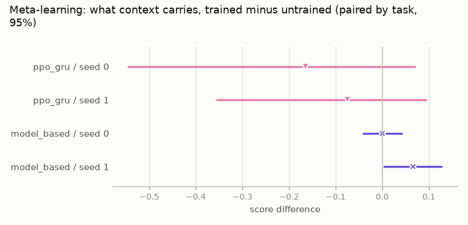

## The three timescales of learning: ppo_gru

Measured under task definition `task/2`, mechanism contract `mech/1`, protocol schema `crucible.research.protocols/1`.

40 fresh tasks, 60,000 environment steps of training (220 weight updates), context cleared every 1 tick(s) in the ablated copy. Training tasks disjoint from evaluation tasks: yes (496 checked). A timescale is attributed when the paired interval excludes zero and the Holm-adjusted p over the three tests is below 0.05.

| timescale | measure | paired difference [95% CI] | p (Holm) | present |
|---|---|---|---|---|
| fast adaptation | score with context intact minus context cleared (trained checkpoint) | 0.954 [0.478, 1.551] | <0.001 | yes |
|  | the same at the untrained checkpoint | 1.118 [0.488, 2.013] |  |  |
|  | late minus early segment, context intact (trained) | -0.004 [-0.029, 0.022] |  |  |
| parametric learning | frozen score, fresh context: trained minus untrained | 0.078 [0.052, 0.106] | <0.001 | yes |
|  | of which without any context | 0.242 [0.008, 0.629] |  |  |
|  | success probability: trained minus untrained | 0.000 [0.000, 0.000] |  |  |
| meta-learning | what context carries: trained minus untrained | -0.164 [-0.545, 0.070] | 0.469 | no |
|  | rise of the within-episode profile (mean minus first segment) | 0.009 [-0.002, 0.023] |  |  |
|  | late minus early segment | 0.011 [-0.005, 0.027] |  |  |

The trained checkpoint is at the untrained checkpoint's final level (-0.169) by segment 1 of 4.

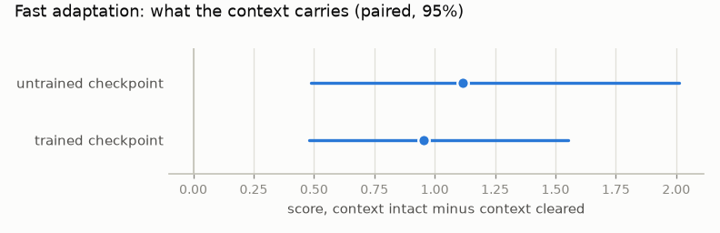

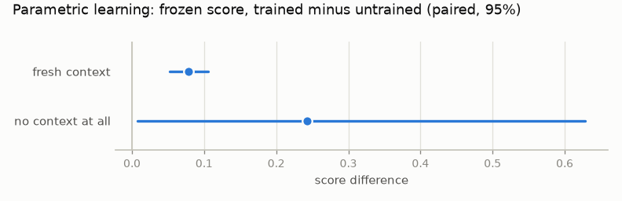

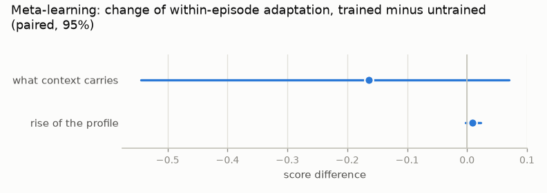

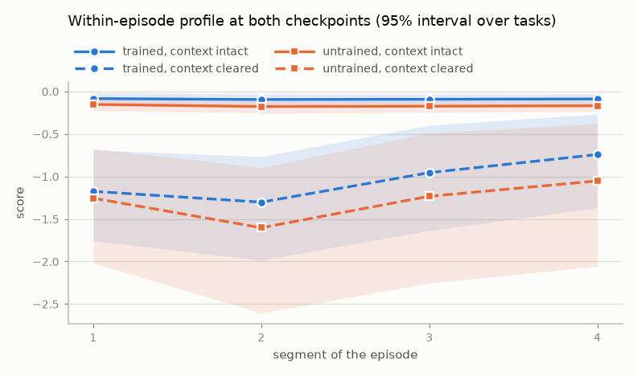

| checkpoint | context | segment 1 | segment 2 | segment 3 | segment 4 |
|---|---|---|---|---|---|
| untrained | intact | -0.154 [-0.226, -0.093] | -0.178 [-0.255, -0.111] | -0.174 [-0.247, -0.113] | -0.169 [-0.235, -0.107] |
| untrained | cleared | -1.255 [-2.017, -0.674] | -1.603 [-2.607, -0.895] | -1.233 [-2.255, -0.489] | -1.053 [-2.056, -0.377] |
| trained | intact | -0.085 [-0.164, -0.018] | -0.095 [-0.171, -0.031] | -0.093 [-0.162, -0.032] | -0.089 [-0.157, -0.027] |
| trained | cleared | -1.175 [-1.757, -0.689] | -1.302 [-1.986, -0.766] | -0.956 [-1.636, -0.399] | -0.742 [-1.368, -0.266] |

Training cost:

| env steps | updates | train CPU s | infer CPU s | train GPU s | infer GPU s | env sim s | infer tokens | search evals | sim cost (cents) | sim net (cents) |
|---|---|---|---|---|---|---|---|---|---|---|
| 60,800 | 220 | 59.88 | 9.18 | 0.00 | 0.00 | 42.31 | 0 | 0 | 180,829,799 | -40,340,238 |

## The three timescales of learning: model_based

Measured under task definition `task/2`, mechanism contract `mech/1`, protocol schema `crucible.research.protocols/1`.

40 fresh tasks, 60,000 environment steps of training (496 weight updates), context cleared every 1 tick(s) in the ablated copy. Training tasks disjoint from evaluation tasks: yes (496 checked). A timescale is attributed when the paired interval excludes zero and the Holm-adjusted p over the three tests is below 0.05.

| timescale | measure | paired difference [95% CI] | p (Holm) | present |
|---|---|---|---|---|
| fast adaptation | score with context intact minus context cleared (trained checkpoint) | 0.215 [0.132, 0.308] | <0.001 | yes |
|  | the same at the untrained checkpoint | 0.215 [0.123, 0.320] |  |  |
|  | late minus early segment, context intact (trained) | 0.311 [0.236, 0.398] |  |  |
| parametric learning | frozen score, fresh context: trained minus untrained | -2.3e-04 [-0.040, 0.042] | 1.000 | no |
|  | of which without any context | 0.000 [0.000, 0.000] |  |  |
|  | success probability: trained minus untrained | -0.075 [-0.175, 0.000] |  |  |
| meta-learning | what context carries: trained minus untrained | -2.3e-04 [-0.040, 0.042] | 1.000 | no |
|  | rise of the within-episode profile (mean minus first segment) | -0.023 [-0.080, 0.042] |  |  |
|  | late minus early segment | -0.071 [-0.153, 0.012] |  |  |

The trained checkpoint is at the untrained checkpoint's final level (0.351) in no segment.

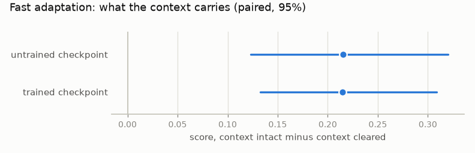

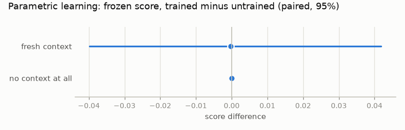

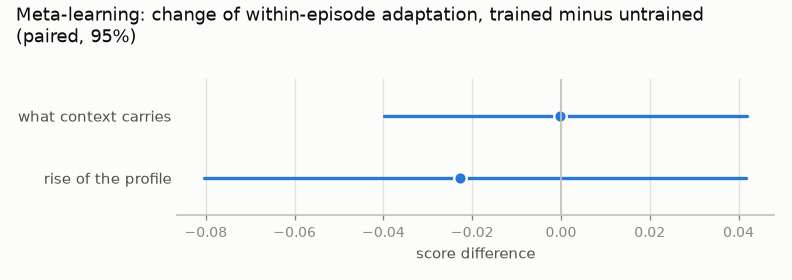

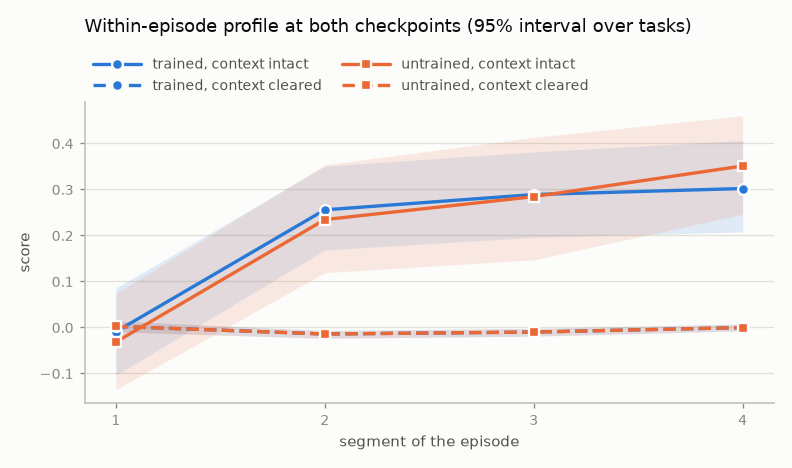

| checkpoint | context | segment 1 | segment 2 | segment 3 | segment 4 |
|---|---|---|---|---|---|
| untrained | intact | -0.032 [-0.135, 0.074] | 0.235 [0.119, 0.354] | 0.284 [0.147, 0.413] | 0.351 [0.246, 0.460] |
| untrained | cleared | 0.002 [-0.009, 0.014] | -0.014 [-0.023, -0.007] | -0.010 [-0.019, -0.002] | -2.6e-04 [-0.007, 0.008] |
| trained | intact | -0.009 [-0.104, 0.086] | 0.256 [0.168, 0.351] | 0.289 [0.196, 0.382] | 0.302 [0.208, 0.407] |
| trained | cleared | 0.002 [-0.009, 0.014] | -0.014 [-0.023, -0.007] | -0.010 [-0.019, -0.002] | -2.6e-04 [-0.007, 0.008] |

Training cost:

| env steps | updates | train CPU s | infer CPU s | train GPU s | infer GPU s | env sim s | infer tokens | search evals | sim cost (cents) | sim net (cents) |
|---|---|---|---|---|---|---|---|---|---|---|
| 60,800 | 496 | 80.67 | 34.00 | 0.00 | 0.00 | 50.89 | 0 | 1,347,165 | 282,538,963 | 71,437,078 |
