# Transfer: final

Measured under task definition `task/2`, mechanism contract `mech/1`, protocol schema `crucible.research.protocols/1`.

| learner | target | category | zero-shot gain | AUC ratio (efficiency) | negative transfer |
|---|---|---|---|---|---|
| ppo_gru | within | within | 0.071 [0.047, 0.100] | - | no |
| ppo_gru | compositional | compositional | 0.035 [0.027, 0.044] | - | no |
| ppo_gru | cross_impl | cross_impl | -0.009 [-0.135, 0.124] | - | no |
| ppo_gru | structural | structural | 0.168 [0.115, 0.224] | - | no |
| model_based | within | within | 0.025 [-0.019, 0.073] | 0.986 [0.837, 1.161] | no |
| model_based | compositional | compositional | -0.021 [-0.173, 0.083] | 1.049 [0.878, 1.268] | no |
| model_based | cross_impl | cross_impl | 0.087 [-0.013, 0.183] | - | no |
| model_based | structural | structural | -0.070 [-0.128, -0.019] | 0.950 [0.900, 0.996] | no |

## Transfer: ppo_gru

Source families: abm_congestion, abm_utility, abm_wom, scm_additive, scm_delay, scm_gate, 60,000 environment steps; seeds [0, 1]. Zero-shot: the source-trained checkpoint, frozen, against the untrained learner on the same tasks. Adaptation: the same interaction budget on the target, starting from the source-trained checkpoint or from scratch (same seeds, same tasks). Efficiency above 1 means the source helped.

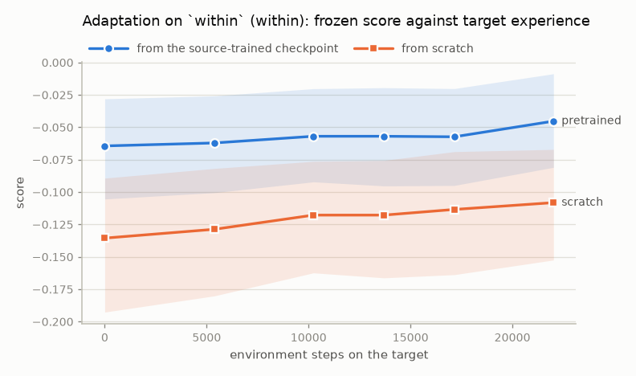

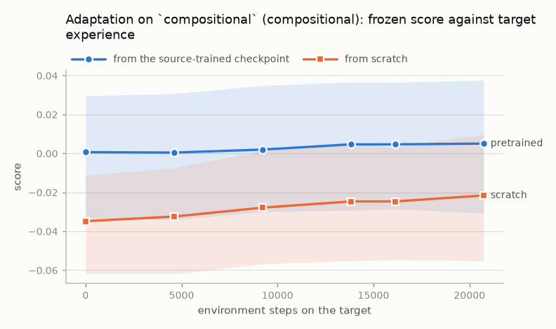

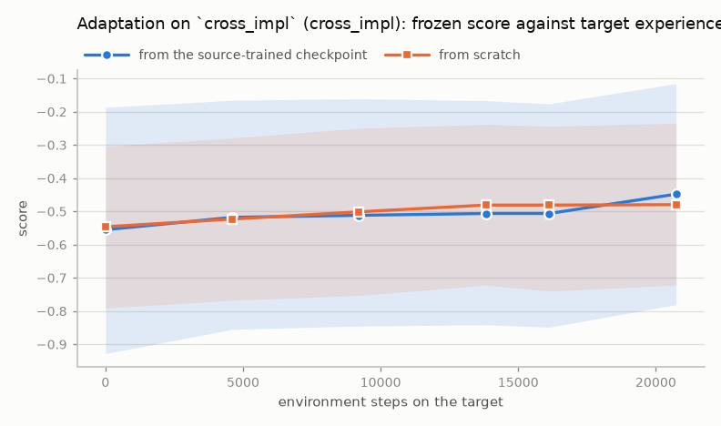

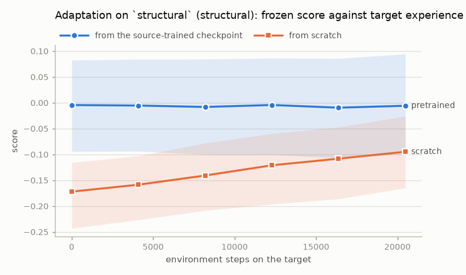

| target | category | pairs (seed x task) | zero-shot, source-trained | zero-shot, untrained | zero-shot gain [95% CI] | AUC from checkpoint | AUC from scratch | AUC difference | AUC ratio (efficiency) | steps-to-0.5 ratio | negative transfer |
|---|---|---|---|---|---|---|---|---|---|---|---|
| within | within | 48 | -0.064 [-0.105, -0.027] | -0.136 [-0.192, -0.089] | 0.071 [0.047, 0.100] | -0.059 [-0.099, -0.021] | -0.122 [-0.174, -0.078] | 0.063 [0.041, 0.088] | undefined (the denominator is not reliably above zero: the ratio is undefined) | neither arm reached the threshold within the budget | no |
| compositional | compositional | 8 | 6.4e-04 [-0.031, 0.030] | -0.035 [-0.062, -0.011] | 0.035 [0.027, 0.044] | 0.003 [-0.031, 0.035] | -0.028 [-0.058, -1.7e-04] | 0.031 [0.022, 0.041] | undefined (the denominator is not reliably above zero: the ratio is undefined) | neither arm reached the threshold within the budget | no |
| cross_impl | cross_impl | 8 | -0.555 [-0.914, -0.198] | -0.547 [-0.792, -0.312] | -0.009 [-0.135, 0.124] | -0.511 [-0.857, -0.170] | -0.503 [-0.750, -0.265] | -0.008 [-0.104, 0.089] | undefined (the denominator is not reliably above zero: the ratio is undefined) | neither arm reached the threshold within the budget | no |
| structural | structural | 16 | -0.005 [-0.092, 0.087] | -0.172 [-0.241, -0.112] | 0.168 [0.115, 0.224] | -0.007 [-0.101, 0.089] | -0.133 [-0.204, -0.071] | 0.127 [0.084, 0.174] | undefined (the denominator is not reliably above zero: the ratio is undefined) | neither arm reached the threshold within the budget | no |

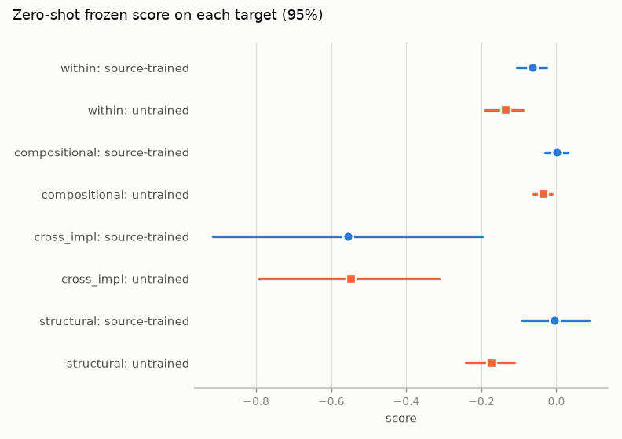

## Transfer: model_based

Source families: abm_congestion, abm_utility, abm_wom, scm_additive, scm_delay, scm_gate, 60,000 environment steps; seeds [0, 1]. Zero-shot: the source-trained checkpoint, frozen, against the untrained learner on the same tasks. Adaptation: the same interaction budget on the target, starting from the source-trained checkpoint or from scratch (same seeds, same tasks). Efficiency above 1 means the source helped.

**Negative transfer** in adaptation: none; zero-shot: ['structural'].

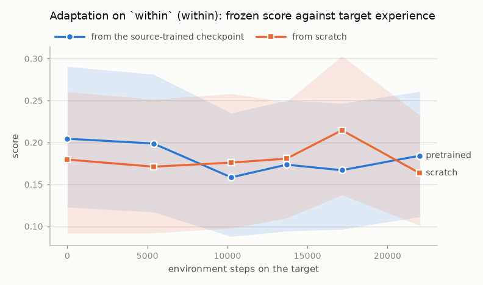

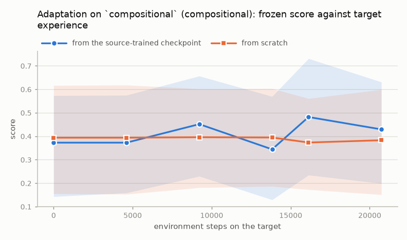

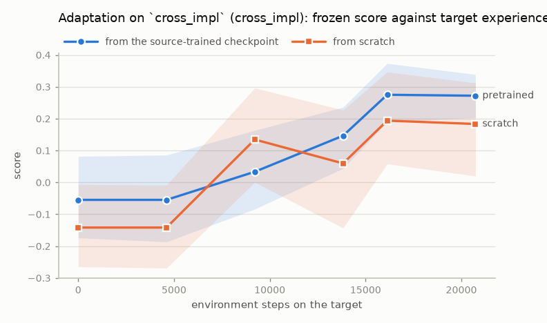

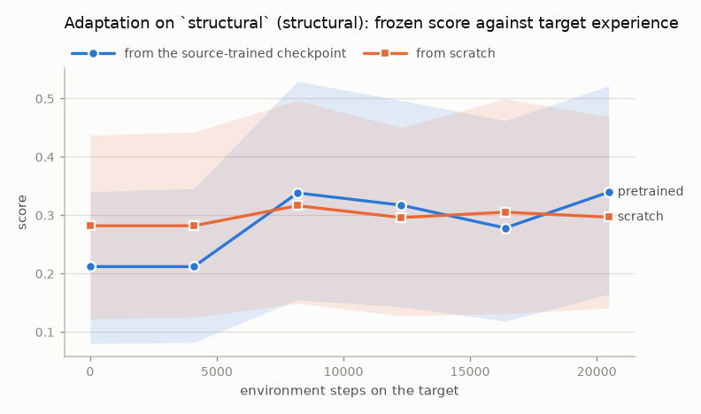

| target | category | pairs (seed x task) | zero-shot, source-trained | zero-shot, untrained | zero-shot gain [95% CI] | AUC from checkpoint | AUC from scratch | AUC difference | AUC ratio (efficiency) | steps-to-0.5 ratio | negative transfer |
|---|---|---|---|---|---|---|---|---|---|---|---|
| within | within | 48 | 0.204 [0.125, 0.288] | 0.180 [0.093, 0.262] | 0.025 [-0.019, 0.073] | 0.180 [0.110, 0.252] | 0.183 [0.113, 0.253] | -0.003 [-0.029, 0.026] | 0.986 [0.837, 1.161] | neither arm reached the threshold within the budget | no |
| compositional | compositional | 8 | 0.373 [0.158, 0.578] | 0.394 [0.158, 0.616] | -0.021 [-0.173, 0.083] | 0.409 [0.199, 0.610] | 0.390 [0.175, 0.596] | 0.019 [-0.051, 0.076] | 1.049 [0.878, 1.268] | neither arm reached the threshold within the budget | no |
| cross_impl | cross_impl | 8 | -0.055 [-0.178, 0.081] | -0.142 [-0.269, -0.010] | 0.087 [-0.013, 0.183] | 0.083 [0.021, 0.133] | 0.040 [-0.042, 0.113] | 0.043 [-0.007, 0.102] | undefined (the denominator is not reliably above zero: the ratio is undefined) | neither arm reached the threshold within the budget | no |
| structural | structural | 16 | 0.212 [0.079, 0.349] | 0.282 [0.118, 0.444] | -0.070 [-0.128, -0.019] | 0.283 [0.125, 0.434] | 0.298 [0.132, 0.458] | -0.015 [-0.030, -7.9e-04] | 0.950 [0.900, 0.996] | neither arm reached the threshold within the budget | no |

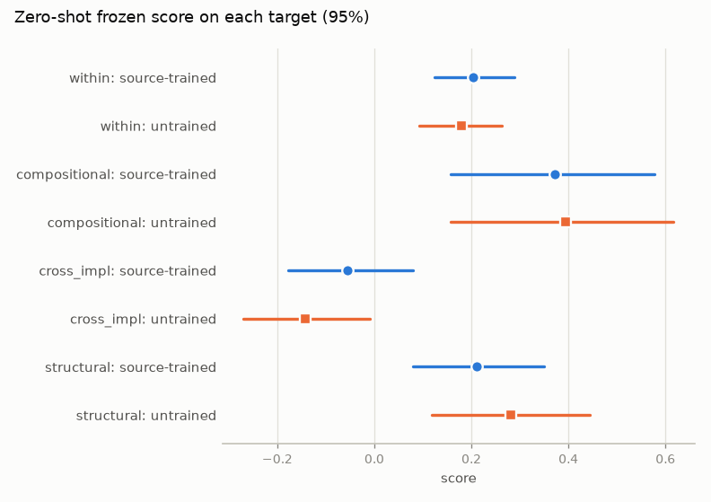

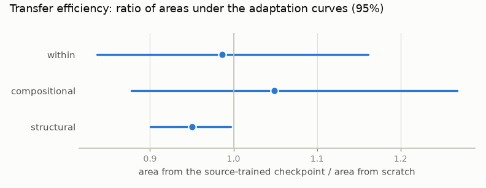
