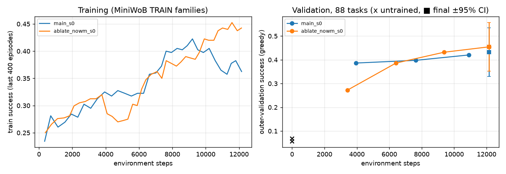
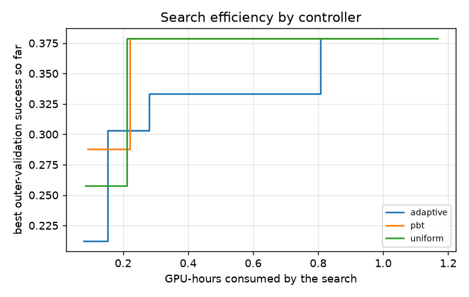

# CAM 2.0 — experiments (measured)

All numbers come from artifacts under `runs/cam2/` (logs, `results.json`, `population.json`, eval JSONs) and are
regenerated by `PYTHONPATH=src python scripts/cam2/report.py` (tables on stdout, `runs/cam2/report.json`,
figures in `docs/figures/`). Hardware: 1× RTX A6000 48 GB, 48 cores; frozen backbone **Qwen/Qwen3-1.7B** (bf16,
1.72 B parameters, snapshot `70d244cc…`); CAM default **65,242,894** trainable fp32 parameters. Success rates are
greedy evaluations with parameter updates disabled (checksum asserted), with 95 % bootstrap CIs over tasks.

Status legend: **MEASURED** (ran, numbers below) · **PARTIAL** (ran at smoke scale) · **NOT RUN**.

## Summary

* **CAM learns through its own weights.** A 65 M-parameter CAM next to a frozen Qwen3-1.7B, trained by recurrent
  PPO for 12k MiniWoB steps, went from 0.068 to 0.432 greedy validation success (0.042 → 0.375 on six never-trained
  families); every update changed 166/167 CAM tensors; the LLM's weights were bit-identical throughout; checkpoints
  reload exactly.
* **It does not yet beat the frozen LLM used directly with the same tools** (validation 0.432 vs 0.500,
  unresolved; locked test of six unseen families 0.083 vs 0.208, LLM better by 0.125 [0.02, 0.25]). It is ~40×
  cheaper in LLM tokens per evaluation and never emits an invalid action (the LLM: 31 %).
* **World model and planning did not help.** No world-model loss scored as well (0.455 vs 0.432); decision-time
  planning changed 0–10 of 88 episodes with no net effect, even when forced.
* **Continual learning:** after training on new families, 73 % of the old families' success remained; a replay
  anchor raised that to 88 % at the cost of ~40 % of the new-family gain (single seed).
* **AppWorld** is integrated end to end with its official evaluator; neither CAM (2k RL steps) nor the frozen LLM
  alone solved any of 24 dev tasks.
* **Outer learner:** three search arms (uniform, PBT, adaptive bandit), 23 candidates trained and evaluated, 9
  promotions, learning-rule mutations included. **No candidate reliably outperformed the hand-designed baseline**
  in a scratch reproduction with independent seeds; one rule mutation was clearly harmful; the adaptive
  controller did not beat uniform or PBT; LLM proposals only copied the best previous edit. Training-seed noise
  (SD ≈ 0.06 at 1.2k steps) was larger than every candidate difference — the main bottleneck (§8).
* Measured totals: 35 training runs (main, ablation, AppWorld, 23 search candidates, 3 retention phases, 6
  reproductions), 118,364 training environment steps (evaluation steps excluded), 21,008 episodes, 1,208 optimiser
  steps, 5.9 h of summed training wall time (up to three runs concurrently on one A6000).

## 1. Smoke experiment: real Qwen3 + real CAM + real environment (MEASURED)

`configs/cam2/main.yaml` — MiniWoB++ via BrowserGym, 16 TRAIN families, 16 Chromium workers, seed 0, 12,000
environment steps (34 updates of 64 complete episodes, 2,176 episodes, 125 optimiser steps), recurrent PPO +
world-model auxiliary loss (B4). Command:

```bash
PYTHONPATH=src python scripts/cam2/train_eval.py --config configs/cam2/main.yaml --eval-initial --verify-reload --eval-train
```

| | value |
|---|---|
| Outer validation, untrained CAM (B2) | **0.068** [0.023, 0.125] (88 tasks) |
| Outer validation after training (B4) | **0.432** [0.330, 0.534] (88 tasks) |
| — validation instances of the 16 TRAIN families | 0.453 |
| — 6 held-out VAL families (never trained on) | 0.375 (enter-text-2 1.0, click-checkboxes-transfer 0.5, focus-text-2 0.5, click-dialog-2 0.25, click-tab-2-easy 0, multi-layouts 0) |
| Fixed TRAIN-family instances (train seed range) | 0.354 [0.208, 0.500] (48 tasks) |
| Train success (sampled policy, last 400 episodes) | 0.234 → 0.363 (peak 0.42) |
| Mean episode length (validation) | 8.6 → 3.8 actions |
| Invalid tool calls | 0 (CAM chooses only schema-valid candidates; validation still runs on every call) |
| Environment errors | 0 |
| Wall time / throughput | 27.2 min training; 35 s collection + 7.8 s update per 64-episode batch (~10 env steps/s) |
| Peak GPU memory (allocated) | 15.7 GB |
| LLM usage | 4,221 generated tokens (text arguments), 148,332 encoded tokens (features; cached by exact text) |
| CAM weights changed | yes: 166 of 167 parameter tensors change at every update; relative update norm 5e-4 – 1.8e-3 per update; an assertion fails the run if an optimiser step leaves CAM unchanged |
| Frozen LLM unchanged | yes: SHA-256 of all weights identical before / after |
| Checkpoint reload | exact: fresh CAM built from `final.pt` has identical tensors and checksum; max |Δ log π| = 0.0 and |ΔV| = 0.0 on 64 recorded decision states |
| Replay exactness | candidate log-prob mismatch ≤ 2.9e-6; text log-prob mean 8e-4 nats, max 0.37 (see LIMITATIONS §3) |

Validation during training (88 tasks, greedy): 0.386 (after 3.9k steps) → 0.398 (7.6k) → 0.420 (10.9k) → 0.432
(final, 12.2k). The untrained CAM succeeds only where the first plausible action already solves the task
(focus-text); the trained CAM solves click/fill/enter families and transfers to some unseen variants
(enter-text-2, click-checkboxes-transfer, focus-text-2) but not to tabs, multi-layouts, multi-step logins or
button sequences.



World-model quality on not-yet-trained-on real transitions improved during the run: next-feature R² from −3.4
to 0.14–0.30, reward R² from −0.13 to 0.62–0.74, termination accuracy 0.65 → 0.73–0.77, measured reliability
0 → 0.38–0.52. Ensemble disagreement was poorly calibrated (correlation with one-step error between −0.7 and +0.6
across updates).

## 2. AppWorld (PARTIAL — integrated end to end, trained at smoke scale, no task solved)

`configs/cam2/appworld.yaml`: AppWorld 0.1.3 `train` split (90 tasks), 6 workers, episodes of up to 15 API calls,
24 episodes per update, same CAM architecture and learner; CAM chooses one of the 457 documented APIs per step and
the frozen LLM writes its JSON arguments under CAM's control vectors; reward from AppWorld's official evaluator
(partial credit only for tests the agent's own calls made pass).

| | value |
|---|---|
| Training | 6 updates, 2,160 API calls, 144 episodes, 72,729 generated tokens (JSON arguments), ~49 min wall (paused and resumed twice from checkpoints to free GPU memory for the searches; resume reproduced the counters and continued) |
| Train success / official score | 0 / 0.18–0.25 per batch (the score counts tests that already pass on the untouched state) |
| Invalid calls during training | 8–17 % of calls per batch (JSON arguments failing the schema) |
| Episode length | always the 15-call limit: CAM never learned to call `supervisor.complete_task` |
| CAM weights changed | yes, 162 tensors per update, relative update norm 1.4e-3 – 2.0e-3 |
| Peak GPU memory (allocated) | 21–32 GB before the memory-bounded text-gradient fix, 23 GB after |
| Text replay mismatch | mean 0.014–0.039 nats, max up to 1.4 nats (long JSON sequences; fix implemented but off, see LIMITATIONS §3) |
| **Evaluation on 24 `dev` tasks (8 scenarios), greedy, no updates** | **success 0/24**, mean official score 0.246 (all from tests passing on the initial state), 0 invalid calls, 6.4 min |

Interpretation: the integration (task loading, API-doc → tool schemas, sandboxed execution, official evaluation,
checkpoint / resume, CAM-controlled JSON generation) works; learning AppWorld tasks from scratch with RL at this
budget does not. The sampled policy picks plausible-looking APIs with LLM-written arguments that are syntactically
valid but semantically wrong (invented ids and tokens); 144 episodes with no positive reward give no learning signal.

## 3. Baselines and ablations on the same 88 validation tasks (MEASURED, single training seed each)

Same environment, tools, observation elements, schema validation, 10-step limit and task list (4 per family);
greedy; parameter updates disabled. Paired Δ = mean per-task difference vs B4 with a bootstrap CI over tasks
(it captures evaluation noise only; training-seed variance — SD ≈ 0.06 at 1.2k steps, §4.1 — is not in it).

| id | system | success [95 % CI] | paired Δ vs B4 | invalid actions | LLM tokens (generated / encoded or prompt) |
|---|---|---|---|---|---|
| B0 | pure-CAM superlearner | not comparable — different environment interface; its test suite passes unchanged | — | — | — |
| B1 | frozen Qwen3-1.7B alone, identical tools/observations, JSON action | **0.500** [0.398, 0.602] | +0.068 [−0.068, +0.205] (21 wins / 15 losses) | **30.9 %** | 7,651 / 202,944 prompt |
| B2 | frozen LLM + untrained CAM | 0.068 [0.023, 0.125] | −0.364 | 0 % | — |
| B3 | frozen LLM + CAM continual RL, no world model (12k steps) | 0.455 [0.352, 0.557] | +0.023 [−0.057, +0.102] | 0 % | — |
| B4 | + world-model auxiliary loss (main run, 12k steps) | 0.432 [0.330, 0.534] | — | 0 % | 511 / 4,274 (eval) |
| B5 | B4 + model-based planning at decision time (calibrated reliability 0.38, u_max 0.079) | 0.432 | 0.000 (0 of 88 episodes changed) | 0 % | — |
| B5f | B4 + planning forced on (no reliability / uncertainty gate) | 0.432 | 0.000 (0 of 88 episodes changed) | 0 % | — |
| B6 | + outer architecture discovery (uniform / PBT arms) | champion = seed configuration (§4) | — | — | — |
| B7 | + adaptive discovery controller | champion = seed configuration (§4) | — | — | — |

Findings, stated plainly:

* **CAM learns** (B2 → B4: 0.068 → 0.432 on validation; 0.042 → 0.375 on the six never-trained families, see §1) — but after
  12k environment steps it is **not better than the frozen LLM prompted with the same tools** (B1 0.500; the
  difference is not resolved, CI −0.07…+0.20). B1 wastes 31 % of its actions on invalid calls (CAM: 0 % by
  construction) yet solves families CAM has not learned (click-tab, click-option, click-button-sequence, login-user,
  click-dialog-2) while CAM is better on typing families (enter-text-dynamic 1.0 vs 0.0, enter-text 1.0 vs 0.25,
  enter-text-2 1.0 vs 0.0). CAM is far cheaper per decision at inference: ~4k encoded tokens (cached features)
  and 511 generated tokens for the whole evaluation vs ~203k prompt tokens and 7.7k generated for B1.
* **The world-model auxiliary loss did not help** at this budget (B3 vs B4: +0.023 for *no* world model,
  unresolved; on fixed train-family instances B3 0.500 vs B4 0.354, Δ +0.146 [+0.04, +0.27] over tasks, one
  training seed each). It costs memory (peak 15.7 GB vs 8.6 GB).
* **Planning was inert.** With the learned world model (next-feature R² 0.14–0.30, reward R² 0.62–0.74 at the
  end of training) the planner's logit bias (mean per-state maximum 0.20) is smaller than the policy's own
  top-1/top-2 margin (0.63): on 128 recorded decision states it changed 0 greedy decisions, and on the 88
  validation tasks it changed 0 episodes, calibrated or forced. So the evidence is "no effect", neither help nor
  harm; a stronger-planning evaluation is in §6.

## 4. Architecture / learning-rule discovery (MEASURED)

Three outer-learner arms with an identical protocol (`configs/cam2/search_{adaptive,uniform,pbt}.yaml`): seed
candidate = the main-run configuration; ASHA with rung 0 = 1,200 and rung 1 = 3,600 environment steps (η = 3);
every candidate trained **from scratch** with its own seed by the real inner learner on MiniWoB TRAIN families and
evaluated greedily on the same 66 outer-validation tasks (3 per family: 6 held-out VAL families + val seeds of the
16 TRAIN families); budget 1.25 GPU-hours / 8 candidates per arm; 10–14 browser workers. Commands:

```bash
PYTHONPATH=src python -m agentrs.cam2.search.outer --config configs/cam2/search_adaptive.yaml --set workers=14
PYTHONPATH=src python -m agentrs.cam2.search.outer --config configs/cam2/search_uniform.yaml --set workers=12
PYTHONPATH=src python -m agentrs.cam2.search.outer --config configs/cam2/search_pbt.yaml --set workers=12
```

Each search persisted its full state (`runs/cam2/search/<arm>/population.json`: candidates, lineage, mutation
history, seeds, checkpoints, every validation episode, compute, hypotheses, events) and was resumed at least once
from it (adaptive: after an infrastructure fix; uniform: after a repair) without redoing finished work.

Per-candidate results (validation success at rung 0 / rung 1; GPU-h = wall-clock hours of the candidate's jobs on the shared GPU):

#### Arm adaptive (adaptive): 8 candidates, 0 failed, champion c000-7b275cffe3
| cid | parent | op | change | params | val r0 | val r1 | GPU-h | status |
|---|---|---|---|---|---|---|---|---|
| c000-7b275cffe3 | — | seed | hand-designed CAM 2.0 configuration | 65.2M | 0.212 | — | 0.079 | ready |
| c001-446249f658 | c000-7b275cffe3 | arch.heads | arch.q_head: True -> False | 64.2M | 0.303 | 0.333 | 0.200 | ready |
| c002-d8569548f6 | c000-7b275cffe3 | arch.llm_interface | arch.prefix_rank: 256 -> 128 | 63.4M | 0.182 | — | 0.079 | ready |
| c003-ed85ba8d60 | c002-d8569548f6 | learn.optim | learn.max_grad: 1.0 -> 2.0 | 63.4M | 0.303 | 0.227 | 0.219 | ready |
| c004-8015f5fe42 | c003-ed85ba8d60 | arch.depth | arch.wm_layers: 2 -> 3 | 68.7M | 0.288 | — | 0.066 | ready |
| c005-fd60c740ab | c001-446249f658 | rule.expr | rule policy:wrap_unary: policy=neg(min(mul(tanh(ratio), adv), mul(clip(ratio, 0.8, 1.2), adv))) / vtarget=ret | 64.2M | 0.091 | — | 0.083 | ready |
| c006-82ac04f1d6 | c003-ed85ba8d60 | rule.crossover | rule crossover: policy=neg(min(mul(ratio, ratio), mul(clip(ratio, 0.8, 1.2), adv))) / vtarget=ret | 63.4M | 0.379 | 0.227 | 0.206 | ready |
| c007-adfbcc57d9 | c006-82ac04f1d6 | arch.recurrence | arch.core: gru -> lstm | 65.5M | 0.273 | — | 0.076 | ready |
#### Arm pbt (pbt): 8 candidates, 0 failed, champion c000-7b275cffe3
| cid | parent | op | change | params | val r0 | val r1 | GPU-h | status |
|---|---|---|---|---|---|---|---|---|
| c000-7b275cffe3 | — | seed | hand-designed CAM 2.0 configuration | 65.2M | 0.288 | 0.379 | 0.221 | ready |
| c001-4a8783c085 | c000-7b275cffe3 | learn.return | learn.lam: 0.9 -> 0.95 | 65.2M | 0.364 | 0.379 | 0.261 | ready |
| c002-b571156184 | c001-4a8783c085 | learn.return | learn.lam: 0.95 -> 0.9 | 65.2M | 0.227 | — | 0.081 | ready |
| c003-70a380c207 | c001-4a8783c085 | learn.return | learn.lam: 0.95 -> 0.9 | 65.2M | 0.121 | — | 0.088 | ready |
| c004-f3eb2ee42f | c001-4a8783c085 | learn.return | learn.gamma: 0.95 -> 0.9 | 65.2M | 0.227 | — | 0.077 | ready |
| c005-4c72a0ecc6 | c000-7b275cffe3 | learn.entropy | learn.ent: 0.01 -> 0.005 | 65.2M | 0.273 | — | 0.094 | ready |
| c006-c31c4f69de | c001-4a8783c085 | learn.entropy | learn.temperature: 1.0 -> 0.7 | 65.2M | 0.152 | — | 0.091 | ready |
| c007-2a86c79fd9 | c001-4a8783c085 | learn.return | learn.gamma: 0.95 -> 0.9 | 65.2M | 0.227 | — | 0.084 | ready |
#### Arm uniform (uniform): 8 candidates, 1 failed, champion c000-7b275cffe3
| cid | parent | op | change | params | val r0 | val r1 | GPU-h | status |
|---|---|---|---|---|---|---|---|---|
| c000-7b275cffe3 | — | seed | hand-designed CAM 2.0 configuration | 65.2M | 0.258 | 0.379 | 0.212 | ready |
| c001-ede448f2fc | c000-7b275cffe3 | rule.crossover | rule policy:subtree: policy=neg(min(mul(ratio, adv), mul(clip(sqrt(adv), 0.5, 0.9), adv))) / vtarget=ret | 65.2M | 0.258 | — | 0.093 | ready |
| c002-2dc205319e | c000-7b275cffe3 | learn.return | learn.gamma: 0.95 -> 0.98 | 65.2M | 0.318 | 0.303 | 0.210 | ready |
| c003-fcdc882864 | c002-2dc205319e | plan | plan.enabled: False -> True | 65.2M | 0.061 | — | 0.080 | ready |
| c004-e635663a48 | c003-fcdc882864 | learn.aux | learn.q_coef: 0.25 -> 0.5 | 65.2M | 0.197 | — | 0.087 | ready |
| c005-45130748c4 | c003-fcdc882864 | learn.entropy | learn.ent: 0.01 -> 0.0125 | 65.2M | 0.273 | 0.242 | 0.241 | ready |
| c006-70cf641272 | c004-e635663a48 | arch.heads | arch.heads: 8 -> 4 | 65.2M | — | — | 0.000 | failed: infrastructure: CUDA OOM caused by a concurrent process on the shared GPU; re-run did not fit the remaining budget; excl |
| c007-0d14f37929 | c004-e635663a48 | arch.world_model | arch.wm_hidden: 1024 -> 512 | 53.4M | 0.379 | 0.121 | 0.246 | ready |

### 4.0 Controller comparison (discovery of discovery)

| arm | candidates evaluated (failed) | GPU-h used | env steps used | best rung-0 val | best rung-1 val | champion | hypotheses improving parent | mean Δ vs parent | operators tried |
|---|---|---|---|---|---|---|---|---|---|
| uniform | 7 (1) | 1.21 | 23,670 | 0.379 | 0.379 | seed | 4/6 | +0.056 | 6: arch.world_model, learn.aux, learn.entropy, learn.return, plan, rule.crossover |
| pbt | 8 (0) | 1.00 | 20,089 | 0.364 | 0.379 | seed | 1/7 | -0.115 | 2: learn.entropy, learn.return |
| adaptive | 8 (0) | 1.02 | 22,924 | 0.379 | 0.333 | seed | 3/7 | -0.011 | 7: arch.depth, arch.heads, arch.llm_interface, arch.recurrence, learn.optim, rule.crossover, rule.expr |

Reading this honestly:

* **No arm found a configuration better than the hand-designed seed**; all three selection reports keep the seed as champion (uniform and PBT: the seed is the best candidate at rung 1, 0.379; adaptive: the best rung-1 candidate, c001 = Q head removed, 0.333, could not be compared at matched budget because the seed was not promoted after a repaired infrastructure failure — the driver now always promotes the seed as a reference).
* **The adaptive controller did not outperform uniform random mutation or fixed PBT.** With 7 proposals it tried 7 different operators (its posterior had no evidence yet; every operator was effectively explored once) and never selected the LLM proposer; PBT spent its whole budget perturbing `lam`/`gamma`/entropy around one lucky parent. The best-so-far curve (figure) is dominated by seed candidates gaining from rung-1 budget. One search per controller with 7–8 candidates cannot rank controllers; the measured noise (§4.1) would need far more proposals.
* The search infrastructure itself worked as specified: typed proposals, admission checks (no candidate failed them), real training of every candidate, paired outer-validation, ASHA promotion, persistent lineage, budget stops and resume.




### 4.1 How large is the noise? (the most important result of the search)

The searches contain **five independent rung-0 trainings of the identical seed configuration** (the seed in each
arm, plus two PBT children that perturbed `lam` back to the seed's value). Their outer-validation success:
0.212, 0.258, 0.288, 0.227, 0.121 — mean 0.221, SD ≈ 0.06. Across all three arms the best rung-0 score of any
mutated candidate is 0.379 (three candidates). With ~20 candidates evaluated, a maximum of this size is what noise
alone produces from a population whose true mean is ~0.22–0.26, so **no rung-0 improvement is distinguishable
from noise**. Rung 1 (3× budget) did not resolve it either: several rung-0 leaders fell back at rung 1
(adaptive c006 0.379 → 0.227; uniform c007 0.379 → 0.121) while their sampled-policy training success kept rising
(uniform c007: 0.30 → 0.36), i.e. greedy evaluation of short-trained policies is itself unstable.

Two effects were large enough to be resolved by the paired per-task CI:

* the learning-rule mutation `policy = −min(tanh(ratio)·A, clip(ratio)·A)` (adaptive c005) **hurt**:
  0.091 vs parent 0.303, paired Δ = −0.21 [−0.32, −0.12];
* parent-relative "improvements" can be artefacts: in the uniform arm, three children of the unlucky 0.061 parent
  (c003) show Δ = +0.14…+0.21 with CIs excluding 0, but their absolute scores (0.197–0.379) are ordinary. Using the
  child-minus-parent difference as the controller's reward (as implemented) is biased by regression to the mean
  when parent scores are single noisy measurements — a design flaw this experiment exposed (see §8).

### 4.2 Learning-rule discovery

Rule mutations evaluated: adaptive c005 (`tanh(ratio)` in the unclipped branch, Δ −0.21, significant), adaptive
c006 (crossover producing `−min(ratio·ratio, clip(ratio)·A)` — the unclipped branch no longer contains the
advantage; rung 0 0.379, rung 1 0.227), uniform c001 (`clip(sqrt(A), 0.5, 0.9)·A` in the clipped branch, Δ 0.0).
All passed the admissibility checks (finite, gradient path, policy-improvement direction on synthetic batches); two
are structurally not PPO re-parameterisations. None is better than PPO-clip by any resolvable margin; one is
clearly worse. The meta-target network operator was never selected in the 21 proposals made.

### 4.3 LLM-guided proposals (§13)

In the adaptive search the bandit never selected `llm.propose` (7 proposals, 17 operators), so its effect on
search efficiency was **not measured in a search**. An offline probe (`scripts/cam2/proposer_probe.py`, no
training) asked the frozen Qwen3-1.7B for 24 proposals per decoding temperature from the adaptive population's
parents and ran each through the full admission checks:

| decoding | admitted | distinct admitted specs | what it proposed |
|---|---|---|---|
| greedy (as used in the search), before the fix below | 0 / 24 | 0 | every answer quoted the number (`"learn.max_grad": "2.0"`), rejected by the typed schema |
| greedy, quoted scalars coerced | 16 / 24 | 4 | always `learn.max_grad: 1.0 → 2.0` (8 others: "no change" because the parent already had it) |
| temperature 0.7, quoted scalars coerced | 16 / 24 | 4 | the same single edit |

The proposer copies the best-scoring change it is shown (the summary lists `learn.max_grad 1.0→2.0` as the top
result) instead of proposing anything new — imitation of noise, not insight. Every proposal stayed inside the
bounded space and none could touch evaluation, budgets, the champion or code (tested: `test_llm_proposal_is_validated_and_bounded`).

### 4.4 Scratch reproduction with independent seeds (promotion check)

`scripts/cam2/reproduce.py`: the seed configuration and the best non-seed candidate of the PBT arm (c001,
`lam 0.9 → 0.95`, rung-1 0.379) and of the adaptive arm (c001, Q head removed, rung-1 0.333) re-trained **from
scratch** with two seeds never used in the search (101, 102), 3,600 environment steps each, evaluated on the same
66 validation tasks; paired over 132 (seed, task) pairs.

| configuration | seed 101 | seed 102 | mean | paired Δ vs seed configuration |
|---|---|---|---|---|
| seed (hand-designed) | 0.394 | 0.348 | 0.371 | — |
| PBT c001 (`lam` 0.95) | 0.348 | 0.379 | 0.364 | −0.008 [−0.061, +0.045] (6 wins / 7 losses) |
| adaptive c001 (no Q head) | 0.394 | 0.379 | 0.386 | +0.015 [−0.030, +0.061] (6 wins / 4 losses) |

**No candidate reliably outperformed the baseline.** The architecture search's best findings reproduce as
"indistinguishable from the hand-designed configuration" (the Q-head removal is the only one with a positive point
estimate; it also saves 1 M parameters).

## 5. Continual learning: retention vs plasticity (MEASURED, single seed)

`scripts/cam2/retention.py`: phase A trains CAM from scratch on 8 TRAIN families (FA = click-button, click-link,
click-test-2, click-dialog, click-checkboxes, click-tab, click-option, focus-text) for ~5k steps; phase B continues
from A's weights *and A's replay buffer* on the other 8 families (FB = enter-text, enter-password, login-user,
click-collapsible, choose-list, click-widget, enter-text-dynamic, click-button-sequence) for ~5k steps, in two arms
with the same seed and budget: **plain** (replay only trains the world model) and **anchor** (replay also anchors
policy and value on A's states, CLEAR-style behaviour KL, `distill_coef = 1.0`). Evaluation: greedy, no updates,
48 held-out instances (val seeds) per family set.

| | FA (old skills) | FB (new skills) | retention of FA | forgetting on FA | gain on FB |
|---|---|---|---|---|---|
| after phase A | 0.542 [0.417, 0.688] | 0.042 [0.000, 0.104] | — | — | — |
| after phase B, plain | 0.396 [0.250, 0.542] | 0.438 [0.312, 0.583] | 73 % | −0.146 | +0.396 |
| after phase B, anchor | 0.479 [0.333, 0.604] | 0.271 [0.146, 0.396] | 88 % | −0.062 | +0.229 |

Training on B does not trivially discard A (73 % retained even without the anchor), and the replay anchor trades
plasticity for retention in the expected direction: forgetting falls from 0.146 to 0.062 while the gain on the new
families falls from 0.40 to 0.23. With one seed and overlapping CIs this is a measured trade-off, not an established
one. The unit test `test_retention_replay_anchor_limits_forgetting` checks the mechanism (the anchor reduces the
KL drift from the old behaviour policy on replayed old-task states).

## 6. Stronger planning and the locked test (MEASURED)

**Forced planning with larger κ** (same B4 checkpoint, same 88 validation tasks, reliability/uncertainty gates
off): κ = 10 changed 3 of 88 episodes (1 better, 1 worse; Δ 0.000 [−0.034, +0.034]); κ = 40 changed 10 episodes
(5 better, 4 worse; success 0.443, Δ +0.011 [−0.057, +0.080]). Model-based planning with this world model neither
helps nor hurts measurably; where it changes decisions, the changes are a coin flip.

**Locked test** — run once, at the end, after all selection; never fed back (`runs/cam2/LOCKED_TEST_ACCESS.log`
holds the single access). Six MiniWoB families never used for training or selection (unicode-test,
login-user-popup, click-collapsible-2, click-checkboxes-soft, use-autocomplete, navigate-tree), 8 test-seed
instances each (48 tasks), greedy, no updates. The search produced no champion other than the seed configuration,
so the main-run checkpoint represents the final system.

| system | locked-test success [95 % CI] | paired Δ vs B4 | invalid actions | per family (non-zero) |
|---|---|---|---|---|
| B1 frozen LLM alone | **0.208** [0.104, 0.333] | **+0.125 [+0.020, +0.250]** | 30.7 % | unicode-test 1.0, click-checkboxes-soft 0.25 |
| B2 untrained CAM | 0.021 [0.000, 0.062] | −0.063 [−0.146, 0.000] | 0 % | click-checkboxes-soft 0.125 |
| B3 CAM, no world model, 12k steps | 0.146 [0.062, 0.250] | +0.063 [−0.042, +0.167] | 0 % | navigate-tree 0.375, unicode-test 0.25, click-checkboxes-soft 0.25 |
| B4 CAM + world model, 12k steps | 0.083 [0.021, 0.167] | — | 0 % | navigate-tree 0.25, click-checkboxes-soft 0.25 |

On families that share no training family's layout, the trained CAM transfers weakly (0.08–0.15) and the frozen
LLM alone is better (the only resolved comparison here: +0.125 for B1 over B4). Learned skill in CAM 2.0 at this
budget is mostly *family-specific*; the LLM's general competence transfers better than what CAM learned on top of it.

**AppWorld B1** (same 24 dev tasks as §2): success 0/24, official score 0.246 (initial-state tests), 96.1 % of
calls invalid (JSON parses — 2.5 % parse failures — but tool names / arguments violate the schemas), 2.0 M prompt
tokens and 13k generated tokens. Neither the frozen LLM alone nor CAM solves AppWorld tasks in this setup.

## 7. Reproducing everything

Environment: `/venv/main` (torch 2.14.1+cu126, transformers 5.23.0, browsergym-core/miniwob 0.14.3, playwright
1.44.0, gymnasium 1.4.0, numpy 2.5.4), MiniWoB++ HTML at `/workspace/ext/miniwob-plusplus`, AppWorld 0.1.3 in
`/workspace/ext/venv-appworld` (setup in `docs/CAM2_ENVIRONMENTS.md`). Every run writes its full configuration,
seeds, LLM name/snapshot/fingerprint, package versions and git commit to `<run_dir>/config.json`. Run at most one
16-worker MiniWoB job at a time on a machine with a 2816-pid limit (≈ 78 threads per browser worker).

```bash
# tests (CPU fixture + real Qwen3-0.6B on GPU where available)
PYTHONPATH=src python -m pytest tests/cam2 -q
# §1 smoke / B2 / B4
PYTHONPATH=src python scripts/cam2/train_eval.py --config configs/cam2/main.yaml --eval-initial --verify-reload --eval-train
# §3 B3 ablation
PYTHONPATH=src python scripts/cam2/train_eval.py --config configs/cam2/ablate_nowm.yaml --set workers=14 --eval-initial --eval-train
# §3 B1 / B4 / B5 on the same validation tasks
CK=runs/cam2/main_s0/ckpt/final.pt
PYTHONPATH=src python scripts/cam2/evaluate.py --llm-only --workers 12 --ckpt $CK $CK $CK \
  --labels B4_main_noplan B5_plan_calibrated B5_plan_forced \
  --plan '{}' '{"enabled": true, "reliability": 0.382, "u_max": 0.079, "min_reliability": 0.2}' \
         '{"enabled": true, "reliability": 1.0, "u_max": 1e9, "min_reliability": 0.0}' --out runs/cam2/eval/baselines_val.json
# §2 AppWorld (+ B1 on AppWorld)
PYTHONPATH=src python scripts/cam2/train_eval.py --config configs/cam2/appworld.yaml --verify-reload --eval-limit 24
PYTHONPATH=src python scripts/cam2/evaluate.py --llm-only --env appworld --workers 6 --max-steps 15 --limit 24 --out runs/cam2/eval/appworld_b1.json
# §4 searches, LLM-proposer probe, scratch reproduction
PYTHONPATH=src python -m agentrs.cam2.search.outer --config configs/cam2/search_adaptive.yaml --set workers=14
PYTHONPATH=src python -m agentrs.cam2.search.outer --config configs/cam2/search_uniform.yaml --set workers=12
PYTHONPATH=src python -m agentrs.cam2.search.outer --config configs/cam2/search_pbt.yaml --set workers=12
PYTHONPATH=src python scripts/cam2/proposer_probe.py --search runs/cam2/search/adaptive --n 24 --out runs/cam2/eval/proposer_probe.json
PYTHONPATH=src python scripts/cam2/reproduce.py --search runs/cam2/search/adaptive runs/cam2/search/pbt \
  --cids c000-7b275cffe3 c001-4a8783c085 c001-446249f658 --seeds 101 102 --steps 3600 --workers 12
# §5 retention
PYTHONPATH=src python scripts/cam2/retention.py --root runs/cam2/retention --steps-a 5000 --steps-b 5000 --distill 1.0 --workers 12
# tables / figures
PYTHONPATH=src python scripts/cam2/report.py
```

Bit-exact reproduction is not expected (browser timing changes batch composition; bf16 kernels are
batch-dependent); greedy evaluation of a fixed checkpoint at a fixed worker count is deterministic.

## 8. Next highest-value technical bottleneck

**Evaluation power, then sample efficiency of the inner learner.** Every comparison in this report — architecture
search, learning rules, the world-model ablation, planning, the controller comparison, CAM vs the prompted LLM — is
limited by the same thing: a 66–88-task greedy evaluation of policies trained for 1–12k steps has a seed-to-seed
SD of ≈ 0.06 and greedy evaluations that swing by up to 0.25, while the effects being searched for are smaller. The
outer learner can only be as good as its fitness signal. Concretely, in order:

1. Make the fitness signal trustworthy: evaluate each candidate on ≥ 300 tasks with sampled *and* greedy policies,
   use ≥ 2 training seeds per rung, compare against repeated reference (seed) measurements instead of the single
   parent, and reward the controller with a noise-aware statistic. This multiplies cost by ~5–10×, which is why
   (2) matters.
2. Raise inner-loop sample efficiency so that candidates separate within budget: CAM after 12k steps does not beat
   the frozen LLM prompted with the same tools. The obvious lever is to start CAM from the LLM's own competence —
   e.g. distil B1's (LLM-only) action choices into CAM's pointer policy before RL (behaviour cloning from the frozen
   LLM on the same observations), or add the LLM's per-candidate log-likelihood as an input feature to the pointer
   network — then let RL improve on it. That would make the "CAM adds capabilities beyond the LLM" claim testable.
3. Only then scale environment diversity (WebArena / Gym-Anything on a Docker host) and the search (more candidates
   per arm, several search seeds per controller).
