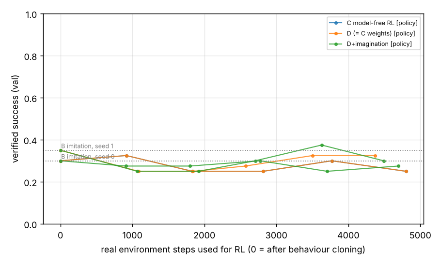

# Experiments

All numbers in this document were produced by code in this repository in the development sandbox
(4 CPU cores, no GPU) and are copied from `results.json` / `metrics.jsonl` files written by the
runs named next to them. Nothing was estimated or extrapolated unless explicitly marked.
Model scale is tiny (Pythia-14M for policy, world model and critic): the results speak to the
platform and to tiny models, **not** to frontier-scale agents.

## Summary of what was measured

* **Imitation is the dominant source of competence.** Behaviour cloning on 400 teacher
  demonstrations raises verified success from 2.5% (pretrained Pythia-14M) to 30–35% on
  validation and 22.5–27.5% on held-out instances/layouts/templates/vocabulary.
* **Model-free RL (tuned PPO, 800 real episodes ≈ 4.4–4.8k steps) did not measurably improve on
  imitation** (val 25% / 32.5% vs BC 30% / 35%; test 30% / 27.5% vs 22.5% / 27.5% for seeds 0 / 1).
* **Planning with the learned world model did not measurably help** on top of the same policy
  weights (val +2.5 pts in both seeds, test −2.5 / 0 pts, unseen families 0 / 0), at ≈9× the
  inference compute per success and ≈9× the wall time per episode. Planner knobs (horizon 1 vs 2,
  uncertainty penalty 0/1/3, policy prior 0.1 vs 1) moved validation success by at most one
  episode out of 40.
* **Imagined training did not measurably help** (val / test / unseen, planner mode: seed 0 27.5 / 27.5 / 3.1% vs
  27.5 / 27.5 / 0% without imagination; seed 1 32.5 / 22.5 / 0% vs 35 / 27.5 / 0%).
* **Without demonstrations nothing is learned:** RL from the pretrained policy succeeded in 3.7% of
  collection episodes and ended at 2.5 / 5 / 0% — observational learning is what makes RL possible
  here at all.
* **Nothing transferred to unseen task families**: every configuration scores 0–6% on the four
  held-out families (at most 2 successes out of 32 episodes; the pretrained policy alone gets 1).
* **The world model itself learns real dynamics and partially transfers.** On held-out instances
  it beats frequency baselines by a wide margin (event NLL 0.05 vs 0.19, AUROC 0.995 vs 0.81,
  reward AUROC 0.97 vs 0.64). On unseen families the 14M models still rank outcomes better than baselines
  (event AUROC 0.71–0.74 vs 0.65, reward AUROC 0.65–0.72 vs 0.50; a 31M world model: 0.79 and
  0.84) but are overconfident, so their
  likelihood is worse than a frequency baseline (event NLL 0.56–0.90 vs 0.31) and their generated
  next observations are worse than "nothing changes" (F1 0.46–0.64 vs 0.81–0.83). Ensemble
  disagreement does flag the model's own errors (AUROC 0.81–0.85).
* **Real browser:** the trained imitation policy produced identical action sequences and outcomes
  in real Chromium (LocalWebEnv) and in the simulator on 20/20 validation episodes.

**Bottom line.** At this scale (14M-parameter models, CPU, 800 RL episodes, 2 seeds, 32–40
evaluation episodes per split) the experiment does **not** support the hypothesis that an
explicitly learned world model with planning and imagination outperforms imitation or model-free
RL. It also does not refute it for larger models: every policy is weak, evaluation intervals are
±12–15 points, and the world model's main failure (overconfidence on unseen dynamics) is exactly
what larger models and better uncertainty calibration might fix. These are the platform's first
measurements, not a verdict on the research question.

## Main comparison (verified success; per-seed values, seed 0 / seed 1)

Evaluation sets: val = 40 episodes (4 per train family), test = 40 (held-out instances, layouts,
templates, vocabulary), test_family = 32 (8 per unseen family). Per-run 95% bootstrap intervals
are about ±0.12–0.15 for 40 episodes.

| configuration | mode | val | test | test_family | real env steps | train PFLOP | inference PFLOP per success (test) |
|---|---|---|---|---|---|---|---|
| A policy-only | policy | 0.025 / 0.025 | 0.025 / 0.025 | 0.031 / 0.031 | 0 | 0 | 2.1 × 10⁻³ |
| B imitation | policy | 0.300 / 0.350 | 0.225 / 0.275 | 0.000 / 0.000 | 0 | 0.144 | 1.9 / 1.2 × 10⁻⁴ |
| C model-free RL | policy | 0.250 / 0.325† | 0.300 / 0.275† | 0.000 / 0.000† | 4802 / 4370 | 0.539 / –† | 1.5 / 1.0 × 10⁻⁴ |
| D model-based | planner | 0.275 / 0.350 | 0.275 / 0.275 | 0.000 / 0.000 | 4802 / 4370 | 0.779 / 0.747 | 1.4 / 1.0 × 10⁻³ |
| D + imagination | policy | 0.275 / 0.300 | 0.275 / 0.250 | 0.031 / 0.000 | 4694 / 4491 | 0.817 / 0.809 | 1.1 × 10⁻⁴ / 1.3 × 10⁻⁴ |
| D + imagination | planner | 0.275 / 0.325 | 0.275 / 0.225 | 0.031 / 0.000 | same | same | 8.4 × 10⁻⁴ / 1.4 × 10⁻³ |

† C seed 1 is D seed 1 evaluated in policy mode. Without imagination, D's policy receives exactly
the same updates as C (the world model only adds planning at decision time); for seed 0 the C and
D final policy weights were verified bit-identical (`results/final/v2_C_s0.json`,
`results/final/v2_D_s0.json`), so a separate C seed-1 run was not executed. Its training compute
equals D seed 1 minus world-model training (≈0.51 PFLOP, not separately measured).
Train PFLOP includes the cached BC / initial world model / critic stages each run used.

**Planning effect on identical weights (D planner − D policy):** val +0.025 / +0.025, test
−0.025 / 0.000, test_family 0.000 / 0.000.

Long-horizon families (`form_validation`, `checkout`; difficulty ≥ 4) on test: B 0.125 / 0.0,
C 0.25 / 0.125, D-planner 0.25 / 0.125. Invalid-action rate is 0 for every learned policy because
the candidate-set restriction makes invalid actions impossible; the "error recovery after invalid
action" metric is therefore undefined here (validation errors and the stochastic server error
are not invalid actions and are handled, e.g. in the example trajectory below).

Learning curves (validation success vs real environment steps; 0 = after behaviour cloning):

Raw per-run files: `results/final/*.json`. Table regenerated with
`python -m agentrs report --runs <run dirs>`.

## Ablations (seed 0)

| # | ablation | val | test | test_family | notes |
|---|---|---|---|---|---|
| 1 | no world model (= C) | 0.250 | 0.300 | 0.000 | |
| 2 | world model, no planning (D policy mode) | 0.250 | 0.300 | 0.000 | identical weights to C |
| 3 | world model + planning (D planner) | 0.275 | 0.275 | 0.000 | 1.8 s/episode vs 0.2 |
| 4 | no observational learning (no demos for any component) | 0.025 | 0.050 | 0.000 | planner mode; RL collection success 3.7% (max 9.4%) |
| 5 | + imagination-based policy training | 0.275 | 0.275 | 0.031 | planner mode; imagined success ≈ 0, uncertainty filter never triggered |
| 6 | no historical replay for the world model | 0.225 | 0.300 | 0.031 | planner mode |
| 7 | planning horizon 2 (vs 1) | 0.250 | – | 0.000 | 6.3 s/episode (3.5× horizon 1) |
| 8 | amount of real experience | see learning curves | | | flat after BC from 0 to ≈4.8k steps |
| 9 | world-model size 31M vs 14M (demos-only WMs, planner on C's final policy) | 0.300 vs 0.275 | – | 0.031 vs 0.063 | 5.1 vs 2.3 s/episode; C policy alone: 0.250 / 0.000 |
| 10 | uncertainty penalty λ = 0 / 1 / 3 | 0.275 / 0.275 / 0.275 | – | 0 / 0 / 0 | |
| – | policy prior β = 1 (vs 0.1) | 0.250 | – | 0.000 | |

## World model on held-out data (seed-0 demonstrations only, Pythia-14M)

Model vs the stronger frequency baseline (P(event | action type)) and vs persistence
("next observation = current observation"); `results/wm_study/eval_pipeline_wm14m_s0.json`.

| eval set | event NLL | event AUROC | event ECE | reward AUROC | terminal AUROC | next-obs F1 | diff exact match | 3-step open-loop F1 | uncertainty→error AUROC |
|---|---|---|---|---|---|---|---|---|---|
| held-out instances (val) | **0.050** / 0.194 | **0.995** / 0.813 | 0.006 | **0.97** / 0.64 | **0.99** / 0.89 | **0.79** / 0.73 | 0.45 | **0.62** / 0.50 | 0.81 |
| held-out inst.+layout+template+vocab (test) | **0.149** / 0.217 | **0.959** / 0.789 | 0.031 | **0.92** / 0.61 | **0.96** / 0.88 | 0.82 / 0.82 | 0.38 | 0.52 / **0.55** | 0.82 |
| unseen families (test_family) | 0.558 / **0.309** | **0.706** / 0.646 | 0.127 | **0.72** / 0.50 | **0.84** / 0.74 | 0.64 / **0.83** | 0.25 | 0.16 / **0.49** | 0.84 |

(model / baseline; bold = better.) Training on demonstrations reduced validation loss from 3.95 to
0.28 (event BCE 0.48 → 0.05, diff NLL 3.47 → 0.23 per token). An independently trained 14M model
(`results/wm_study/eval_cli_wm_dev_s0.json`) reproduces the pattern (unseen-family event NLL 0.90
vs 0.31; AUROC 0.74 vs 0.65).

### World-model size (14M vs 31M, identical training: 800 steps on the seed-0 demonstrations)

`results/wm_study/eval_cli_wm_dev_s0.json`, `results/wm_study/eval_cli_wm_dev31m_s0.json`;
baseline = P(event | action type), persistence for F1/drift.

| eval set | model | event NLL | event AUROC | ECE | reward AUROC | terminal AUROC | next-obs F1 | 3-step F1 | uncertainty→error AUROC |
|---|---|---|---|---|---|---|---|---|---|
| held-out instances | 14M | 0.062 | 0.991 | 0.012 | 0.97 | 0.98 | 0.850 | 0.668 | 0.82 |
| | 31M | 0.072 | 0.994 | 0.016 | 0.95 | 0.99 | 0.857 | 0.622 | 0.81 |
| | baseline | 0.194 | 0.813 | – | 0.64 | 0.89 | 0.743 | 0.496 | – |
| held-out inst.+layout+template+vocab | 14M | 0.142 | 0.972 | 0.027 | 0.95 | 0.97 | 0.799 | 0.599 | 0.79 |
| | 31M | 0.153 | 0.975 | 0.031 | 0.94 | 0.97 | 0.811 | 0.584 | 0.83 |
| | baseline | 0.217 | 0.789 | – | 0.61 | 0.88 | 0.795 | 0.557 | – |
| unseen families | 14M | 0.895 | 0.737 | 0.167 | 0.65 | 0.76 | 0.463 | 0.251 | 0.81 |
| | 31M | 0.780 | 0.791 | 0.161 | 0.84 | 0.84 | 0.545 | 0.125 | 0.85 |
| | baseline | 0.309 | 0.646 | – | 0.50 | 0.74 | 0.809 | 0.492 | – |

The larger world model is no better in-distribution but transfers its *ranking* of outcomes to
unseen families clearly better (reward AUROC 0.84 vs 0.65); both remain overconfident there
(likelihood worse than the frequency baseline) and their multi-step open-loop rollouts degrade
faster than persistence. Training losses reached 0.026 (14M) and 0.009 (31M) on 1,175 transitions —
both models fit the demonstration data almost perfectly.

## Continual learning (6 cycles, seed-0 BC start; `results/continual/continual_report.json`)

Actor and evaluator ran as separate processes against a fixed, versioned production checkpoint;
every candidate was evaluated against production on frontier + regression families. Actor
success per cycle: 0.34, 0.28, 0.25, 0.34, 0.16, 0.34. All six candidates scored exactly the same
validation success as production (+0.000) and were promoted under the tie-permissive gate
(`min_improvement: 0`); measured forgetting 0; the curriculum stayed at stage 0 because frontier
competence never reached the 0.5 threshold. One PPO update per 32-episode cycle at lr 3e-5 does
not change the greedy policy's choices measurably — the loop works mechanically, the learning
signal per cycle is too small.

## Example: world-model predictions next to real outcomes

`docs/example_trajectory.txt` (from `agentrs visualize --store ... --world-model ...`) shows a
successful `form_validation` episode. The world model predicts value changes correctly but at
step 0 binds the change to the wrong field id (`e337` instead of `e338`); at the submit step it
predicts the navigation to `/welcome` with P(success) = 0.58 and elevated uncertainty, reflecting
the family's stochastic "server busy" failure on ~35% of first submissions.

## What would be needed to test the hypothesis properly

* Larger pretrained models (the research profile: Qwen3-4B policy, Qwen3-0.6B world model) — the
  14M policy cannot copy goal strings into the right fields reliably, which caps every variant.
* More evaluation episodes (≥ 200 per split) and ≥ 5 seeds; the current intervals cannot resolve
  differences below ≈ 15 points.
* A better-calibrated world model on unseen dynamics (temperature scaling on held-out families,
  larger ensembles of independent models instead of heads on a shared trunk) and an uncertainty
  threshold set from the model's actual uncertainty distribution.
* A critic trained on the agent's own (not the teacher's) outcome distribution before it is used
  for planning, and a longer RL budget.

## Protocol

**Environment.** MiniWeb (simulated web apps with server-side verification); see
`docs/architecture.md`. Reward: 1 if the environment verifier confirms success at termination,
else 0; a −0.1 shaping penalty for invalid actions is applied by the RL objective (not by the
environment). Discount γ = 0.95.

**Splits** (no task or answer from a held-out split can enter training; enforced in code):

| split | families | instances | layouts | goal templates | vocabulary |
|---|---|---|---|---|---|
| train (demos + RL) | 10 train families | seed range 0 | default, reversed | all but the last | train vocabulary |
| val (model selection) | 10 train families | seed range 1M | default, reversed | all but the last | train vocabulary |
| test (held-out instances) | 10 train families | seed range 2M | + `distractors` | all, incl. held-out | disjoint vocabulary |
| test_family (held-out tasks) | 4 unseen families | seed range 3M | all | all | disjoint vocabulary |

The held-out families exercise dynamics seen in training in new combinations
(`dialog_confirm`: open dialog → confirm; `scroll_find`: scroll to reveal; `toggle_settings`:
switches + save; `lookup_then_fill`: read a value on one page, type it on another).

**Configurations** (all share the starting checkpoint `EleutherAI/pythia-14m`, the 400
teacher demonstrations (40 per family, ε = 0.15 noise), the RL task stream, reward, evaluation
sets and hardware class):

| | policy init | demos | RL | world model | planning at decision time | imagined training |
|---|---|---|---|---|---|---|
| A policy-only | pretrained | – | – | – | – | – |
| B imitation | pretrained | BC | – | – | – | – |
| C model-free RL | BC | BC | PPO, 25 × 32 episodes | – | – | – |
| D model-based (planning) | BC | BC + WM | same as C | trained on demos + all real experience | MPC (K=4, H=1) | – |
| D + imagination | BC | BC + WM | same as C | same | MPC | Dyna-style, H=2, uncertainty-filtered |

Because training is deterministic per seed and D without imagination uses exactly C's policy
update stream, **D's policy weights are bit-identical to C's** (verified); D-policy vs D-planner
therefore isolates the effect of world-model planning on fixed weights.

**Model selection.** Hyperparameters were chosen on the `val` split only. `test` and
`test_family` were evaluated once per final checkpoint.

**Uncertainty.** Per-run 95% bootstrap intervals over episodes; across seeds, the mean and a
bootstrap interval over seeds. With 2 seeds, seed-level intervals are very coarse.

**Compute accounting.** FLOPs are counted per backbone forward pass (2·params·tokens) and ×3 for
training passes; reported separately for policy training, world-model training, critic training
and inference (including planning). Real environment interactions are counted in steps and
episodes. Cached shared stages (BC / initial world model / critic) are charged to every run that
uses them.

## Findings during development (measured, including failures)

These were found by tests or by monitoring runs; each changed the code or the protocol.

1. **Hash-seed nondeterminism confounded the first comparison.** `product_names()` iterated a
   Python `set`, so `checkout`/`search_lookup` task instances depended on `PYTHONHASHSEED` and
   differed between experiment processes. The pilot comparison (`results/pilot/`) is therefore
   *not* controlled and is not reported as a result. Fixed; a test now regenerates tasks and
   teacher episodes under three hash seeds and requires identical output. After the fix, an
   RL run is bit-reproducible: the final seed-0 C run reproduced the per-iteration statistics of
   the tuning run exactly.
2. **PPO step size.** With lr 1e-4 (full fine-tuning of Pythia-14M), per-update approximate KL was
   0.1–0.4, the clip fraction 25–43%, KL early stopping fired almost every iteration, entropy rose,
   and validation success fell from 0.30 (BC) to 0.175 after 5 iterations
   (`results/tuning/v2_C_s0_lr1e-4_aborted_metrics.jsonl`). On the val split, lr 1e-5 and 3e-5 gave
   KL ≈ 0.002–0.02 and val success 0.30 / 0.325 after 5 iterations; 3e-5 was selected. All C/D runs
   reported below use the tuned value; the aborted lr 1e-4 runs are not reported as results.
3. **Planner-collected data is strongly off-policy.** Training PPO on episodes collected by the
   softmax planner gave approximate KL ≈ 7.6 against the recorded behaviour probabilities in a
   smoke run (immediate early stop). Main runs therefore collect on-policy and plan at decision
   time; planner data is supported via truncated importance weights or search distillation.
4. **Length bias of sequence-likelihood policies.** An untrained LM policy put ≈99% of its
   probability on the shortest action (`finish()`; entropy 0.014), so on-policy RL from scratch
   never received a reward (all advantages zero, no update). Found by a failing test. BC
   initialisation removes it; `length_norm` is available for RL from scratch.
5. **Small demonstration sets overfit.** With 20 demonstrations per family (pilot), BC raised
   held-out imitation accuracy but *increased* validation NLL (4.94 → 5.06). Doubling to 40 per
   family and halving the learning rate gave NLL 4.83 → 2.11 with accuracy 13.6% → 47.5%.
6. **The critic trained on demonstrations is uninformative.** Teacher demonstrations succeed ≈90%
   of the time, so the initial critic learns "high value everywhere" (V(s₀) AUROC 0.25–0.28 on the
   small validation set, mean V(s₀) 0.76). It keeps training on the agent's own returns during RL.
7. **Memory.** In the RL phase one experiment process grows to ≈2 GB; running 8 in parallel on a
   15 GB machine triggered the OOM killer twice. Runs were restarted from scratch (deterministic);
   `scripts/mem_queue.sh` now admits jobs only when memory is available.
